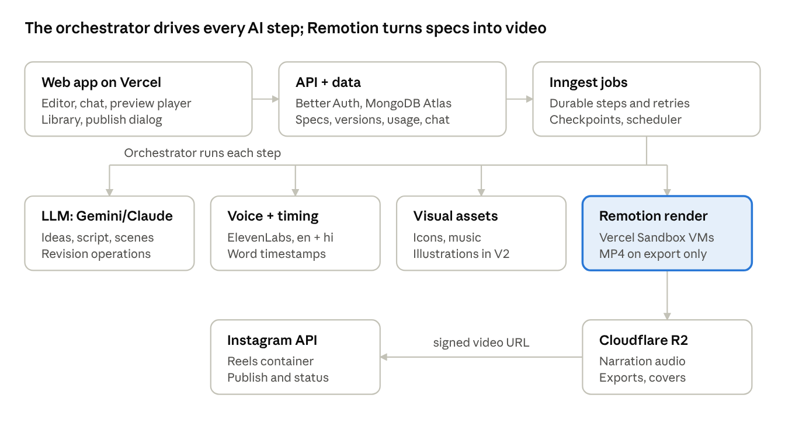

# PRD — Vidcosmos

Nov 10, 2026 · @Rajwant Prajapati

Revised 10 Nov 2026 to match the [System Design](https://claude.ai/artifact/SZ5aHmXe9VFYaaHMZi9K9J), [Database Design](https://claude.ai/artifact/PoRFUsZ4eBRQxQ79Nk21Us), [API Design](https://claude.ai/artifact/ERmNphEXFQCK7eiYZWVFs6) and [screen designs](https://claude.ai/artifact/1zw824yRx2C5bKhGyyu9UF). What changed since the 24 Oct version:

- Vidcosmos is for any kind of AI-generated video; explainers ship first.
- Three formats in V1: 9:16, 16:9 and 1:1.
- ElevenLabs is the only voice provider, for English and Hindi (Sarvam, Azure and Deepgram removed).
- Gemini is the default LLM; Claude works through the same interface.
- V1 visuals are icons, diagrams, charts and kinetic text; AI illustrations and stock move to V2.
- The preview plays live in the browser; an MP4 is rendered only on export.
- The whole app, including creating and editing, works on phones.

## 1. Overview

V1 ships a web studio where a user turns an idea into a 30–90 second animated, narrated video and posts it to Instagram, without editing software. Product name: Vidcosmos, tagline "A universe of videos, made by AI." Vidcosmos is for any kind of AI-generated video: explainers, product promos, stories, travel, quotes and more. V1 ships explainers first and most polished; the same flow and templates serve the other types.

### Problem

Educators, creators and small brands need a steady stream of short videos: explainers, product promos, stories and announcements. Making one by hand takes hours across scripting, design, animation, voiceover, captions and posting. Existing AI tools mostly target viral "faceless" content and give weak control over accuracy, structure and individual scenes.

### Product vision

Vidcosmos is an AI studio for any kind of short video, starting with explainers: idea → script → storyboard → animated, narrated video → Instagram. Users refine any part, the whole video or one scene, by chatting with the AI. Motion graphics (animated diagrams, charts, kinetic text, icons) are the visual language in V1; AI illustrations and generated footage come later.

### Goals for V1

1. A first-time user produces a publishable 60-second video in under 15 minutes.
2. Users can change the whole video or one scene by chat without restarting.
3. No work is lost: autosave, version history, and recovery from any failed step.
4. One-click post or schedule to Instagram.
5. Generation cost per 60-second video is measured from day one.

### Non-goals for V1

- Billing and paid plans (V2)
- Platforms other than Instagram (V2)
- AI illustrations, AI images and stock clips (V2)
- AI avatars, voice cloning, full generative-video scenes as default (V3)
- Teams, roles and approvals (V3)
- Videos longer than 90 seconds (V3)
- Native mobile apps (the web app is fully responsive, and the whole create flow works on a phone)

### Assumptions (to confirm)

- Primary V1 users: educators, coaches, creators and small brands; explainers are the first video type.
- V1 languages: English and Hindi (narration and captions).
- Team of 3 or fewer at launch, so Remotion's free license applies.
- V1 output formats: 9:16 (default), 16:9 and 1:1, chosen per video and changeable later without new narration.
- Beta access is open sign-up, protected by per-account usage limits.

## 2. Target users and personas

V1 is built for the educator persona first; the other two use the same flow with lighter needs.

| Persona | Who | Main job to be done | What they care about most |
| --- | --- | --- | --- |
| Educator (primary) | Teacher, tutor, coach, course creator | Explain one concept clearly in 60–90 seconds | Accuracy, clear structure, diagrams, Hindi/English narration |
| Creator | Solo creator running an Instagram, YouTube or LinkedIn page | Post 3–5 short videos a week | Speed, hooks, captions, scheduling |
| Small brand | Founder or marketer at a small business | Promote a product, explain a service, announce an offer | Professional look, consistency, low effort |

### User stories (V1)

- As an educator, I want to type a topic and get structured script options, so I don't start from a blank page.
- As a user, I want to edit the script and storyboard before rendering, so I control what gets said.
- As a user, I want visuals that animate in time with the narration, so the video feels professionally made.
- As a user, I want to say "make scene 3 a comparison diagram" and have only that scene change.
- As a user, I want my work saved automatically and to see clearly what the system is doing.
- As a user, I want to preview, export an MP4, and post or schedule to Instagram from the same place.
- As a user, I want to see how much of my monthly limit is left before I start a video.
- As a user, I want to pick vertical, landscape or square for each video, so it fits where I will post it.
- As a user, I want to create and edit videos on my phone, not only on a laptop.

## 3. Scope

V1 has ten modules; billing, more platforms and brand kits wait for V2. This is the feature list approved on 24 Oct 2026, revised on 10 Nov 2026 (three formats in V1; illustrations and stock moved to V2).

### V1: Launch

| # | Module | Includes |
| --- | --- | --- |
| M1 | Ideation | Topic input, "suggest ideas", 5–10 angles with hooks, bring-your-own idea/notes/outline |
| M2 | Script generation | Length targeting (30/60/90 s), format (9:16, 16:9, 1:1), tone, audience level, language, inline edit, hook–body–recap structure |
| M3 | Storyboard | Auto scene split; per scene: narration, on-screen text, visual type, duration; reorder, add, delete, duplicate |
| M4 | Motion graphics | Animated diagrams and charts, kinetic text, animated icons and shapes, a layout per format, transitions |
| M5 | Voiceover and sync | AI voices, word-level timing, narration-driven scene duration, synced captions, music with ducking |
| M6 | Conversational revisions | Chat panel, whole-video and scene-level changes, change preview, undo |
| M7 | Reliable generation | Autosave, version history, plain-language progress, per-scene retry, resumable jobs, failed renders not counted, completion notification |
| M8 | Preview and export | In-browser preview, scene scrubbing, draft preview, MP4 720p/1080p in the video's format, SRT and audio download, cover frame |
| M9 | Instagram publishing | Connect professional account, post now, schedule, AI caption/hashtags/cover, status tracking, retry |
| M10 | Library and account | Projects library, sign up/login, workspace, per-account usage limits with counter |

### V2: Growth

- Credit-based billing (Razorpay and/or Stripe)
- Brand kit: logo, colors, fonts, intro/outro, watermark, default motion style
- Series/autopilot mode with approval queue or auto-post
- Content calendar
- More platforms: YouTube Shorts, LinkedIn, Facebook, TikTok
- Templates: how it works, myth vs fact, top 5, step-by-step
- AI illustrations, AI images and stock clips; upload own assets; PDF, blog or notes to video
- Fact-check and source citations
- More regional languages with correct on-screen script rendering

### V3 and later

- Voice cloning and AI avatar presenter
- Post analytics and "what to make next" suggestions
- Teams, roles, approval workflows
- Longer videos (3–10 min) with chapters
- Translate or dub existing videos
- API and white-label for edtech platforms

## 4. User flows

Every video moves through five user-facing stages: Idea → Script → Storyboard → Video → Publish. The user can step back to any earlier stage; later stages are marked stale and regenerate only what changed.

### F1. Sign up and onboarding

1. User signs up with Google or email + password (email verified by link or OTP).
2. Onboarding asks three optional questions: role (educator, creator, brand), main topic area, preferred narration language.
3. Answers set defaults for tone, audience level, voice and language.
4. User lands on the dashboard: "Create video" button, usage counter, recent projects, and an Instagram-connect prompt.

### F2. Create a video (happy path)

1. **Start.** User clicks "Create video" and a project is created and autosaved immediately as "Untitled video".
2. **Idea.** User either:
   - types a topic and clicks "Suggest angles": AI returns 5–10 angles, each with a hook line; or
   - pastes their own idea, notes or outline and clicks "Use my idea".
3. **Settings.** User picks format (9:16, 16:9 or 1:1), length (30/60/90 s), tone, audience level, language and voice. Defaults come from onboarding.
4. **Script.** AI writes a script sized to the length (\~2.5 words per second). User edits inline; the word count and estimated duration update live.
5. **Storyboard.** User clicks "Build storyboard". AI splits the script into 2–10 scenes. Each scene card shows narration, on-screen text, visual type (diagram, chart, kinetic text, icons) and estimated duration. User can reorder, add, delete, duplicate or edit any card.
6. **Generate.** User clicks "Generate video". The usage check runs; the system shows staged progress (Section 6). User can leave the page; work continues.
7. **Preview.** When the draft is ready, the preview player opens with a scene strip below it.
8. **Revise (optional).** User chats or edits scenes (F3). Only scenes whose narration changed get new audio; the preview updates at once.
9. **Finalize.** User clicks "Export" or "Publish" (F4, F5). The MP4 is rendered at this point; the preview never needs a render.

### F3. Conversational revision

1. User opens the chat panel, or selects a scene first to scope the chat to it.
2. User types a request, e.g. "make it more casual" (whole video) or "turn this into a timeline" (selected scene).
3. AI replies with a change summary: which scenes change and how, plus whether voiceover will be regenerated.
4. User clicks "Apply" or "Cancel", or keeps chatting to adjust the plan.
5. On Apply, a new version is saved; only scenes whose narration changed get new audio, and the preview updates at once.
6. "Undo" restores the previous version instantly (narration audio is cached, so nothing regenerates).

If the request is ambiguous ("make it better"), the AI asks one clarifying question with 2–3 suggested options instead of guessing.

### F4. Preview and export

1. Preview plays live in the browser from the scene specs and narration (Remotion Player); the user can jump to any scene.
2. User clicks "Export", picks 720p or 1080p. The format comes from the video; to change it, the user switches format in the editor first.
3. If a final render of that format exists and is current, download starts immediately; otherwise a final render job starts with progress.
4. User can also download captions (SRT) and narration audio (MP3), and pick a cover frame from the timeline.

### F5. Connect Instagram and publish

1. User clicks "Connect Instagram" (dashboard, settings or publish dialog).
2. Meta OAuth opens; user logs in and grants permissions; the app stores a long-lived token.
3. App checks the account is a professional account and shows its handle and avatar.
4. From a finished video, user clicks "Publish". The dialog shows AI-generated caption, hashtags and cover, all editable, and warns when the video is not 9:16 (Instagram shows other shapes with blank space).
5. User chooses "Post now" or "Schedule" (date, time, shown in the user's time zone).
6. Post now: status moves Uploading → Processing → Published, with a link to the post. Schedule: the post appears in the library as Scheduled and can be edited or cancelled until 5 minutes before its time.
7. On failure, the user is notified with a plain reason and a "Retry" button.

### F6. Library and usage

1. Library lists projects with thumbnail, title, stage (Draft, Rendering, Ready, Scheduled, Published, Failed) and last edited time.
2. Filters: stage, format, language; search by title and topic.
3. Actions per project: open, duplicate, rename, delete (soft delete, recoverable for 30 days).
4. The usage counter shows videos used / monthly limit and the reset date.

### F7. Return after leaving mid-generation

1. User closes the tab during a render.
2. The job continues on the server.
3. On return, the project opens at the current stage with live progress, or shows the finished preview and a "Your video is ready" banner. An email is sent if the render finished while the user was away.

## 5. Functional requirements

Each module lists what it must do and how we will know it works. IDs (FR-x.y) are for tracking in the build.

### M1. Ideation

- FR-1.1 Topic input up to 500 characters; notes/outline input up to 5,000 characters.
- FR-1.2 "Suggest angles" returns 5–10 angles. Each angle has a title, a one-line hook and a target audience level.
- FR-1.3 "More like this" on an angle returns 5 variations; "Regenerate" returns a fresh set. Previous sets stay visible in a history list.
- FR-1.4 Optional inputs: audience description, goal (teach, promote, announce).
- Acceptance: angles return in under 10 s (p90); selecting one advances to Script with the angle prefilled.

### M2. Script generation

- FR-2.1 Target length 30, 60 or 90 s maps to about 75, 150 or 225 words (2.5 words/s, adjusted per voice speed).
- FR-2.2 Controls: tone (friendly, professional, energetic, calm), audience level (kids, beginner, intermediate, expert), language (English, Hindi in V1).
- FR-2.3 Script structure: hook (first 3 s), body (2–5 key points), recap or call to action.
- FR-2.4 Inline rich-text editing; live word count and estimated duration; warning when estimate exceeds target by more than 15%.
- FR-2.5 "Rewrite selection" on highlighted text (shorter, simpler, more engaging).
- Acceptance: script generated in under 15 s (p90); duration estimate within ±10% of final narration length.

### M3. Storyboard

- FR-3.1 AI splits the script into 2–10 scenes for 30–90 s videos; each scene is 3–15 s.
- FR-3.2 Each scene card stores: narration text, on-screen text (≤ 12 words), visual type, layout template, visual elements, estimated duration.
- FR-3.3 Visual types in V1: diagram (flow, cycle, comparison, timeline), chart (bar, pie), kinetic text (title, bullets, key term, stat callout), icon grid, quiz and recap. Illustrations, AI images and stock clips are V2.
- FR-3.4 User can reorder (drag), add, delete, duplicate, and edit any field; change visual type from a dropdown.
- FR-3.5 Narration across all scenes always equals the full script; editing a scene's narration updates the script and vice versa.
- Acceptance: storyboard built in under 20 s (p90); every scene validates against the scene schema before render.

### M4. Motion graphics generation

- FR-4.1 The LLM outputs a structured scene spec (JSON) per scene; the renderer draws it with Remotion templates. No frame is generated as a raw image by the LLM.
- FR-4.2 V1 template library (12): title, bullets, key term, flowchart (linear or cycle, 3–6 steps), comparison (2 columns), timeline (3–6 points), bar chart and pie chart (≤ 6 values), icon grid (2–6 icons), stat callout, quiz, recap. Each template has a layout for each format.
- FR-4.3 Every element has entrance, emphasis and exit animations; timing is bound to narration words (M5).
- FR-4.4 Icons come from an open icon set (Iconify/Lucide); icon choice is AI-suggested and user-swappable via search.
- FR-4.5 Illustrations move to V2. There they are generated once per scene with a per-video style prompt so all scenes share one look, and the user can regenerate one.
- FR-4.6 Video theme: one of 4 palettes (midnight, paper, ocean, sunset); font pair from a fixed licensed set.
- FR-4.7 Text auto-fits its box; nothing renders outside the format's safe area (9:16: top 14% and bottom 20% kept clear of key text for Instagram's UI; 16:9 and 1:1: 5% on every side).
- FR-4.8 Formats: 9:16 (1080×1920), 16:9 (1920×1080) and 1:1 (1080×1080), chosen per video with 9:16 as the default. Text limits are the same in all three, so changing format after the storyboard keeps narration and audio, switches layouts, and never makes a valid scene invalid.
- Acceptance: a 60 s video's preview is ready within 3 min of Generate (p90); no clipped or overlapping text in automated layout checks, in every format.

### M5. Voiceover and narration sync

- FR-5.1 TTS provider: ElevenLabs (multilingual model, with timestamps) for English and Hindi, behind one internal voice interface so providers can be swapped. Kokoro is a free local voice for development only.
- FR-5.2 Voice picker: a female and a male Indian voice in V1, each with a 5 s sample in English and Hindi; more voices later.
- FR-5.3 Speed control (0.85×–1.15×).
- FR-5.4 Narration is generated per scene; word-level timestamps are stored per scene. ElevenLabs returns character timestamps, which become word timings; there is no separate alignment service.
- FR-5.5 Scene duration = narration duration + 0.3 s lead-in + 0.4 s tail (configurable).
- FR-5.6 Each visual element declares a trigger word; it animates in when that word starts (±100 ms).
- FR-5.7 Captions: word-synced, 2 styles or off (classic, highlight current word, none); max 2 lines, 32 characters per line.
- FR-5.8 Background music: 10–20 licensed tracks by mood; auto-ducked 12 dB under narration; user can mute or pick a track.
- FR-5.9 Pronunciation fix: user can add a respelling for a word (e.g. "GIF → jif") applied before TTS.
- Acceptance: measured offset between word audio and its visual trigger ≤ 100 ms in 95% of triggers.

### M6. Conversational revisions

- FR-6.1 Chat panel on the editor page; scope chip shows "Whole video" or "Scene N" (set by selecting a scene).
- FR-6.2 Supported change types: script tone/length/content, scene visual type/layout/elements, on-screen text, voice/speed, music, theme/palette, caption style, format, scene add/remove/reorder.
- FR-6.3 AI responds first with a change plan: list of affected scenes and what changes. Nothing is applied until the user clicks Apply.
- FR-6.4 Apply creates a new project version; only scenes whose narration changed get new audio, and the preview updates without a render.
- FR-6.5 Global changes that alter timing (voice, speed, length) regenerate narration for every scene; the plan states this. A format or theme change keeps all narration.
- FR-6.6 Undo/redo across versions; chat history is saved with the project.
- FR-6.7 Out-of-scope requests (e.g. "add my face") get a short explanation and the nearest supported alternative.
- Acceptance: a single-scene change is playable in under 60 s (p90); unaffected scenes keep their spec and audio unchanged.

### M7. Reliable generation

- FR-7.1 Autosave every edit within 2 s of the change; "Saved" / "Saving…" / "Offline – changes kept locally" indicator.
- FR-7.2 Version history: a version is created on each generation, Apply, and manual "Save version"; keep the last 50 per project; restore any.
- FR-7.3 Progress shows named stages with scene-level detail: Writing script → Planning scenes → Recording voice (n of N) → Syncing visuals to the voice → Saving → Done.
- FR-7.4 Every pipeline step is idempotent and checkpointed; a failed step retries automatically up to 3 times with backoff before surfacing an error.
- FR-7.5 A failed scene does not fail the video: other scenes complete; the failed scene shows "Retry this scene" and a fallback (simpler template) option.
- FR-7.6 Jobs survive browser refresh, tab close and server restarts.
- FR-7.7 Usage is counted only when a video's first full draft completes successfully; failed or cancelled generations are not counted.
- FR-7.8 User can cancel a running generation; completed scenes are kept.
- FR-7.9 In-app and email notification when a generation or export longer than 60 s finishes.
- Acceptance: zero lost edits in chaos tests (kill workers mid-job); 99% of started videos reach Ready without user intervention.

### M8. Preview and export

- FR-8.1 In-browser preview with Remotion Player: play, pause, seek, scene strip, captions toggle.
- FR-8.2 Preview plays from scene specs plus narration audio, so edits show without a full render.
- FR-8.3 Final export: MP4 (H.264, AAC), 30 fps, in the video's format: 9:16 at 720×1280 or 1080×1920, 16:9 at 1280×720 or 1920×1080, 1:1 at 720×720 or 1080×1080.
- FR-8.4 Extra downloads: SRT captions, MP3 narration, PNG cover frame.
- FR-8.5 Export files are kept 30 days after last access, then regenerated on demand.
- Acceptance: final 60 s 1080p render under 4 min (p90); output passes Instagram Reels spec checks.

### M9. Instagram publishing

- FR-9.1 Connect via Meta OAuth (Instagram API with Instagram Login); one connected account per workspace in V1.
- FR-9.2 Require a professional account; detect and explain if the account is personal.
- FR-9.3 Publish through the Reels flow: create container with public video URL → poll status until FINISHED → media\_publish.
- FR-9.4 AI-generated caption (≤ 2,200 characters), up to 15 hashtags, cover frame; all editable before posting.
- FR-9.5 Schedule: date/time picker in user time zone; minimum 10 minutes ahead; maximum 75 days ahead.
- FR-9.6 Publish states: Scheduled, Uploading, Processing, Published, Failed; shown in library and project.
- FR-9.7 Check the account's publishing limit before each publish; refresh tokens before expiry.
- FR-9.8 Any format can be posted as a Reel. Instagram accepts 0.01:1 to 10:1 but recommends 9:16, so 16:9 and 1:1 posts get a warning before they are scheduled.
- Acceptance: 98% of publish attempts succeed when the account is valid; failures show a specific reason.

### M10. Library and account

- FR-10.1 Auth: Google OAuth and email/password with verification; password reset.
- FR-10.2 One personal workspace per user in V1.
- FR-10.3 Projects library with stage, thumbnail, search, filters, duplicate, rename, soft delete (30-day recovery).
- FR-10.4 Usage limits per account: default 20 videos/month and 30 applied chat revisions per video; admin-configurable per account.
- FR-10.5 Usage counter on dashboard and before generation; clear message and reset date when the limit is reached.
- FR-10.6 Account settings: profile, default format/language/voice, connected Instagram, delete account (with data deletion).
- FR-10.7 Internal admin page: users, usage, cost per video, failed jobs, limit overrides.

## 6. System workflows

Generation runs as a durable, checkpointed job per video, with each scene as its own step, so one failure never restarts the whole video.

### W1. Generation pipeline

1. **Validate.** Check usage limit, moderation of topic/script, storyboard schema. Fail fast with a user-readable reason.
2. **Lock version.** Snapshot the project as version N; the job works only on that snapshot, so user edits during the job don't corrupt it.
3. **Per-scene fan-out** (scenes run in parallel, max 4 concurrent per video):
   1. Apply pronunciation fixes; send narration to TTS; store audio + word timestamps.
   2. Turn the provider's character timestamps into word timings.
   3. Resolve assets (icons in V1); cache by content hash.
   4. Compute timing: scene duration from audio; bind each element's trigger word to a frame number.
   5. No video is rendered here: the preview plays live from the spec and audio.
4. **Check.** Save the timings into the spec and run the layout checks for the video's format.
5. **Ready.** Save the version, mark the project Ready, notify the user, count usage.
6. **Final render** (on export/publish): Remotion renders the whole video in its format and resolution on Vercel Sandbox, mixing music with ducking and burning in captions; reuses cached audio. Exports are cached by spec hash and resolution, so a version renders once per resolution.

Every step writes a checkpoint (status, output URL, content hash). On retry or resume, a step whose inputs hash matches a completed checkpoint is skipped.

### W2. Revision

1. LLM receives: current project JSON, scope (video or scene ids), user message, chat history.
2. LLM returns typed revision operations (update, add, remove or move a scene; set format, theme, voice or music) plus a plain-language summary.
3. Server validates the diff against the schema; invalid diffs are retried once, then the user gets "I couldn't apply that, try rephrasing."
4. User clicks Apply → new version N+1.
5. Dirty-checking per scene: narration changed → redo TTS + timing; visuals, theme or format only → nothing to regenerate; global timing change → all scenes.
6. The preview updates at once; an MP4 is rendered only when the user exports.

### W3. Instagram publish job

1. At post time (or immediately), re-check the token and the account's publishing limit.
2. Make the final MP4 reachable at a short-lived public signed URL.
3. Create a Reels container with the video URL, caption and cover.
4. Poll container status every 15 s, up to 10 minutes, until FINISHED.
5. Call media\_publish; store the media id and permalink.
6. On error: retry transient errors 3 times with backoff; on permanent errors (token revoked, account not professional, spec rejected) mark Failed with the reason and notify.

### W4. Scheduler

- A scheduler checks every minute for posts due in the next minute and enqueues W3.
- Scheduled posts store the exact final render id; if the user edits the video after scheduling, they are asked whether to update the scheduled post.

### State models

| Object | States |
| --- | --- |
| Project | Draft → Generating → Ready → (Revising → Ready) → Published; Failed is reachable from Generating/Revising |
| Scene narration | Pending → Running → Done / Failed → (Retrying → Done / Failed) |
| Publish job | Scheduled → Uploading → Processing → Published / Failed; Cancelled from Scheduled |
| Instagram connection | Connected → Expiring → Expired/Revoked → Reconnect required |

## 7. Edge cases and error handling

The rule for every case: keep the user's work, say plainly what happened, and offer one clear next action.

| Area | Edge case | Expected behavior |
| --- | --- | --- |
| Ideation | Topic is empty, gibberish or one word | Ask for a bit more detail; offer 3 example topics |
| Ideation | Topic is harmful, adult, hateful or medical/legal advice framed as fact | Moderation blocks it with a neutral message; medical/legal topics allowed with a disclaimer line added to the script |
| Ideation | Topic is too broad for 90 s ("history of India") | Angles narrow it ("3 turning points…"); note that it was narrowed |
| Script | User edits script far beyond target length | Warning with estimated duration; offer "Trim to fit" or switch to a longer length |
| Script | Script language doesn't match chosen voice language | Block generation; offer to translate script or change voice |
| Script | Mixed Hindi/English (Hinglish) | Allowed; the ElevenLabs multilingual voice reads it; captions keep the script as written |
| Script | Numbers, formulas, abbreviations, URLs | Normalize for TTS ("2x" → "two times"); keep original form on screen |
| Storyboard | User deletes all scenes | Disable Generate; prompt to rebuild from script |
| Storyboard | Scene narration over 15 s | Suggest splitting the scene; auto-split on accept |
| Storyboard | On-screen text too long for layout | Auto-shrink to min size, then truncate with warning badge on the card |
| Storyboard | Diagram needs more items than template max (e.g. 9 steps) | Split across two scenes or switch to list template; tell the user |
| Motion graphics | Icon search returns nothing relevant | Fall back to a generic shape + label; user can search icons |
| Motion graphics | (V2) Illustration generation fails or is flagged | Retry once with a safer prompt; else use icon-grid fallback for that scene |
| Motion graphics | Devanagari or long words break layout | Font set includes Devanagari; layout checks run per language |
| Voiceover | TTS provider down or rate-limited | Retry with backoff; then pause the job and let the user retry later (no second provider in V1) |
| Voiceover | TTS mispronounces a term | User adds pronunciation fix; only that scene's audio regenerates |
| Voiceover | Timestamps missing or misaligned | Fall back to evenly spaced triggers within the scene and flag it |
| Revisions | Ambiguous request | Ask one clarifying question with options |
| Revisions | Request outside V1 (avatar, face, 5-minute video) | Explain limits; suggest closest supported change |
| Revisions | Request conflicts with locked content (user-edited text) | Plan flags it: "This will overwrite your edits to scene 2" before Apply |
| Revisions | User edits manually while a revision is being applied | Edits save to a new draft version; when it finishes, user chooses which to keep |
| Revisions | Per-video revision limit reached | Explain limit; manual edits and preview still allowed |
| Reliability | Browser offline mid-edit | Save locally; sync on reconnect; conflicts resolved last-write-wins per field with a notice |
| Reliability | Same project open in two tabs | Second tab becomes read-only with "Take over editing" button |
| Reliability | Worker crash mid-scene | Job resumes from last checkpoint on another worker |
| Reliability | Scene fails after 3 retries | Video completes with that scene marked; options: retry, fallback template, or edit scene |
| Reliability | Whole job stuck over 15 min | Auto-cancel, mark Failed, refund usage, alert admin |
| Usage | Limit reached mid-month | Generation disabled with reset date; editing, preview, export and publish of existing videos still work |
| Usage | Generation fails | Not counted (FR-7.7) |
| Export | Requested format not yet rendered | Start final render; download when ready; email link |
| Export | Export file expired from storage | Regenerate from saved specs (no usage charge) |
| Export | Format changed after an export or a scheduled post | Existing exports and scheduled posts keep their file; the next export renders the new format |
| Instagram | Personal (non-professional) account | Explain how to switch to professional in the Instagram app, with a link to Meta's help |
| Instagram | Token expired or permissions revoked | Mark connection Expired; pause scheduled posts; email user to reconnect |
| Instagram | Daily API publishing limit reached | Delay to next available slot; notify user |
| Instagram | Video rejected (spec, duration, copyright audio) | Mark Failed with Meta's reason; offer re-export or mute music |
| Instagram | Container stays IN\_PROGRESS over 10 min | Mark Failed (timeout), offer Retry |
| Instagram | User deletes video that has a scheduled post | Warn first; deleting cancels the scheduled post |
| Instagram | Scheduled time is in the past (e.g. after downtime) | Post within 15 min of recovery if under 2 h late; otherwise ask the user |
| Instagram | Time zone change or DST | Store schedule in UTC; display in current user time zone |
| Account | User deletes account | Cancel scheduled posts, revoke Instagram token, delete data within 30 days |
| Account | Email already registered via Google | Offer Google sign-in; link accounts after verification |

## 8. Technical architecture and AI stack

The core design choice: the LLM writes a structured scene spec, and code-based motion templates render it. This keeps cost low, makes every scene editable, and makes narration sync exact.

The web app only edits the project spec; the orchestrator runs every AI and render step, and finished files reach Instagram through signed URLs from storage.

### Stack

| Layer | Production choice | Free/trial option for prototyping | Notes |
| --- | --- | --- | --- |
| Web app and hosting | Next.js on Vercel (Mumbai) | Vercel Hobby (non-commercial; Pro plan for launch) | Remotion Player embeds directly; API routes host the backend |
| Auth | Better Auth | Open source, free | Google + email/password; official MongoDB adapter, no schema migrations |
| Database | MongoDB Atlas | Atlas free cluster | Project specs and versions stored as JSON documents |
| Job orchestration | Inngest | Free tier | Durable steps, retries, checkpoints, scheduled posts; runs on Vercel functions |
| LLM | Gemini (Flash) by default; Claude through the same interface | Gemini free tier | Structured JSON output for specs and revision operations; switched with LLM\_PROVIDER |
| Voice (English and Hindi) | ElevenLabs (with timestamps) | Free plan (no commercial use) | Paid plan required before launch |
| Motion graphics | Remotion | Free for teams of up to 3 | Automators license if team grows |
| Rendering | Remotion on Vercel Sandbox | Usage-based on your Vercel plan | Each render runs in a short-lived Linux VM; no AWS setup; delete sandbox snapshots and temp files after each job |
| Icons | Iconify / Lucide | Free | Open source |
| Illustrations | V2: FLUX (via fal.ai/Replicate) or Gemini image | Trial credits | One style prompt per video |
| Stock media | V2: Pexels, Pixabay APIs | Free | Attribution where required |
| Music | Licensed library | Pixabay Music for prototyping | Verify license before launch |
| Storage/CDN | Cloudflare R2 | Free tier | Signed public URLs for Instagram |
| Moderation | OpenAI Moderation API or Azure Content Safety | Free | Topic, script, image prompts |
| Publishing | Instagram Graph API (Reels) | Free | Meta app review needed |
| Email | Resend or Postmark | Free tiers | Render-ready, publish alerts |
| Monitoring | Sentry + PostHog | Free tiers | Errors and product analytics |

### Key design rules

- All AI providers sit behind internal interfaces (LLM, TTS, image, alignment), so any provider can be swapped without product changes.
- The project spec (JSON) is the single source of truth. Preview, render, revisions and versions all read it.
- Every generated asset is cached by a hash of its inputs; unchanged inputs never regenerate.

### Data model (MongoDB collections)

The full schemas, indexes and rules are in the [Database Design (V1)](https://claude.ai/artifact/PoRFUsZ4eBRQxQ79Nk21Us): 20 collections, 5 owned by Better Auth and 15 by the app. Each project holds its settings (format included) and a draft VideoSpec; versions, chat messages, jobs, assets, exports, social accounts and posts hang off it.

## 9. Non-functional requirements

Targets below are for V1 beta, up to about 1,000 active users.

| Area | Requirement |
| --- | --- |
| Performance | Editor pages load in under 2 s; ideas under 10 s, script under 15 s, storyboard under 20 s (p90) |
| Render time | 60 s draft under 3 min; single-scene revision under 60 s; 1080p final under 4 min (p90) |
| Capacity | 50 concurrent video generations; queue shows position when full |
| Availability | 99.5% monthly for the web app; jobs never lost during outages |
| Durability | Specs and versions in MongoDB Atlas; a nightly mongodump to R2 while on the free cluster, point-in-time recovery once on a dedicated cluster; assets in R2 |
| Security | HTTPS everywhere; Instagram tokens encrypted at rest; workspace ownership enforced on every database query; signed, expiring asset URLs |
| Privacy | Paid AI tiers that don't train on customer data before launch; privacy policy and data deletion on request; comply with India's DPDP Act |
| Moderation | Topic, script, chat requests and image prompts checked before generation; blocked content logged for review |
| Licensing | Only licensed fonts, music and stock; attribution stored where required; Remotion license tracked against team size |
| Accessibility | Keyboard-navigable editor; captions on by default in exports; WCAG AA contrast in UI |
| Browsers | Latest Chrome, Edge, Safari, Firefox on desktop; the full app on mobile web, including creating and editing |
| Observability | Per-job logs and traces; alerts on failure rate over 5% or queue wait over 5 min; cost per video tracked per provider |
| Meta compliance | Pass Meta app review for Instagram publishing permissions; follow platform terms and rate limits |

## 10. Limits, metrics, costs, risks and plan

### Usage limits (V1 defaults)

| Limit | Default | Notes |
| --- | --- | --- |
| Videos per month | 20 | Counted on first successful draft |
| Applied chat revisions per video | 30 | Manual edits and preview not counted |
| Max video length | 90 s |  |
| Idea/script regenerations | 50 per video | Prevents LLM abuse |
| Storage of exports | 30 days after last access | Regenerated on demand |

All limits are admin-configurable per account.

### Success metrics

- Activation: % of sign-ups who finish a first video within 24 h (target 40%).
- Time to first video: median under 15 minutes.
- Generation success: 99% of started videos reach Ready without user intervention.
- Revision use: % of videos with at least one chat revision (shows the feature is valued).
- Publishing: % of finished videos exported or posted (target 60%).
- Retention: % of users who make a video in week 4 (target 25%).
- Cost: average provider cost per 60 s video, tracked weekly.

### Cost model (per 60 s video, to be measured in beta)

- Narration: about 900 characters; at ElevenLabs Multilingual pay-as-you-go rates (about $0.10 per 1,000 characters) roughly $0.09, plus regenerations.
- LLM calls: ideas, script, storyboard, specs, revisions; expected to be small next to voice and images. Measure in beta.
- Illustrations: none in V1 (moved to V2), which removes the largest variable cost.
- Rendering: Vercel Sandbox compute per export only (the preview needs no render); plus Remotion's $0.01 per render only if the team grows past 3 people.
- Target: total provider cost under $0.50 per 60 s video, so V2 pricing has healthy margins.

### Risks and mitigations

| Risk | Impact | Mitigation |
| --- | --- | --- |
| Crowded market of faceless-video tools | Hard to stand out | Lead with accuracy, motion graphics quality, Hindi/Indic narration, scene-level chat editing |
| Meta app review delays | Publishing blocked at launch | Apply early (week 2); export works without it; test with dev-mode accounts |
| Provider outages or price changes | Failed renders, margin loss | Provider interfaces; cached narration; cost tracking per video |
| Free-tier terms (no commercial use, data used for training) | Legal/privacy exposure | Switch to paid tiers before public launch |
| Template visuals feel repetitive | Lower perceived quality | Grow template library; per-video palettes; illustrations in V2 |
| AI factual errors in educational content | Trust damage | User review step before render; V2 fact-check with sources |
| Render cost spikes from heavy revision use | Losses before billing exists | Usage limits; per-account cost alerts; Vercel Spend Management caps |

### Delivery plan (indicative, team of 2–3)

1. **Weeks 1–2: Foundations.** Auth, workspace, project model, autosave, versioning, job orchestration skeleton; start Meta app setup.
2. **Weeks 3–4: Script engine.** Ideation, script, storyboard, scene spec schema.
3. **Weeks 5–7: Motion + voice.** Remotion template library (12 templates), TTS with timestamps, sync, captions, music, preview player.
4. **Weeks 8–9: Reliability + revisions.** Checkpoints, per-scene retry, progress UI, chat revisions with typed operations.
5. **Week 10: Export + Instagram.** Final render, downloads, connect, post, schedule, status.
6. **Weeks 11–12: Hardening + beta.** Usage limits, admin page, moderation, edge-case tests, closed beta with 20–50 users.

### Open questions

- Resolved 10 Nov: any kind of AI video, explainers first, for educators, creators and small brands.
- Resolved: English and Hindi, both voiced by ElevenLabs.
- Confirm Vidcosmos availability: .com/.ai/.in domains, Instagram handle, and IP India trademark search in classes 9 and 42.
- Default usage limit: is 20 videos/month right for beta?
- Captions burned into the video, attached as a separate file, or both?
- Resolved 10 Nov: icons, diagrams, charts and kinetic text in V1; illustrations in V2.
- The create flow's video type chips (explainer, promo, story, travel, quote) need a field: extend idea.goal or add a videoType to the database and API.
