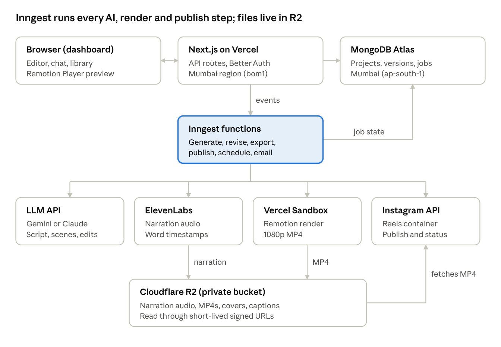
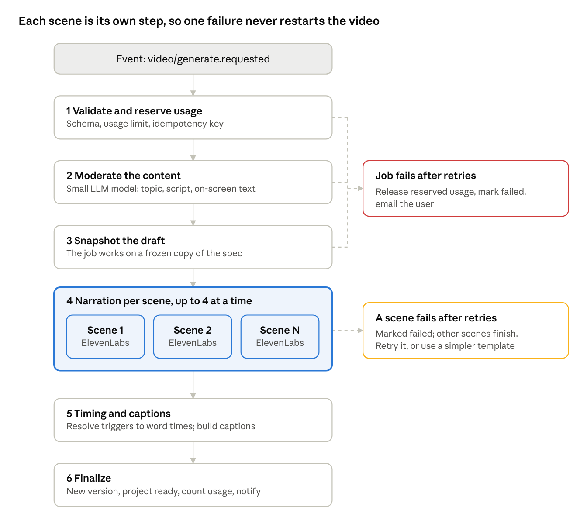

# Vidcosmos — System Design (V1)

Nov 10, 2026 · @Rajwant Prajapati

## 1. Overview

This document defines how V1 of the Vidcosmos dashboard is built. It is one Next.js app on Vercel (Mumbai), backed by MongoDB Atlas (Mumbai). Durable Inngest jobs drive every AI and render step, files live in Cloudflare R2, and Remotion draws the same video in the browser preview and in Vercel Sandbox renders. The scope is the V1 feature list in the PRD: ideation, script, storyboard, motion graphics, narration sync, conversational revisions, reliable generation, preview and export, Instagram publishing, library, and usage limits.

### Decisions this design is built on

| Area | Decision |
| --- | --- |
| Hosting | Vercel, functions in `bom1` (Mumbai) |
| Database | MongoDB Atlas on AWS `ap-south-1` (Mumbai) |
| Auth | Better Auth (Google + email/password), sessions in MongoDB |
| Jobs | Inngest: every AI, voice, render and publish step |
| LLM | Gemini (free tier, default) or Claude behind one provider interface, chosen by LLM\_PROVIDER. Used for ideas, script, storyboard, revisions, captions and moderation |
| Voice | ElevenLabs only, for English and Hindi, Indian male and female voices |
| Visuals | Remotion templates: diagrams, kinetic text, icons, shapes. No AI-generated images in V1 |
| Rendering | Remotion on Vercel Sandbox, output uploaded to R2 |
| Storage | Cloudflare R2, private bucket, short-lived signed URLs |
| Email | Resend |
| Monitoring | Sentry (errors), PostHog (product analytics), Inngest dashboard (jobs) |

### Where this design differs from the PRD

- **Voice:** ElevenLabs is the single provider for English and Hindi. Sarvam, Deepgram and Azure are not used (decided 9 Nov).
- **Illustrations:** V1 ships icons, diagrams and text animations only. No image-generation provider; illustrations move to V2.
- **Preview needs no render.** The Remotion Player plays the spec and narration audio live in the browser. A "re-render" after a revision means regenerating only the changed scenes' narration and timing, which takes seconds. An MP4 is rendered only on export or publish.
- **Moderation uses the configured LLM** (a small classification call) instead of a separate moderation API, keeping one provider per job.
- **Scheduling uses Inngest's durable sleep** (`step.sleepUntil`) instead of a once-a-minute cron. A cron every 15 minutes reconciles any missed posts.

**LLM provider (decided 10 Nov):** the PRD names Claude. This design runs Gemini on its free tier by default, with Claude supported through the same interface. Switching is a configuration change (Section 8).

### Out of scope for V1

Billing, teams and roles, platforms other than Instagram, autopilot series, brand kits, AI images and avatars, videos over 90 s, and native mobile apps. The design leaves room for each one (Section 20).

## 2. Architecture

The web app only reads and edits data. Anything slow, paid or failure-prone is a step in an Inngest function, and that step records its progress in MongoDB.



The browser never talks to an AI provider directly. Inngest functions call the LLM (Gemini or Claude) and ElevenLabs, render in Vercel Sandbox, and write results to R2 and MongoDB. The browser plays narration and MP4s from R2 through signed URLs. At publish time, Instagram fetches the MP4 from R2 through a signed URL.

| Component | Responsibility | Talks to |
| --- | --- | --- |
| Browser (dashboard) | Library, idea and script steps, storyboard editor, chat, live preview, export and publish dialogs | Next.js API; R2 through signed URLs |
| Next.js app | Pages, REST API, auth, input validation, ownership checks, signing R2 URLs, sending Inngest events | MongoDB, Inngest, R2 (signing only) |
| Inngest functions | Every slow or paid step: LLM calls, narration, timing, rendering, publishing, scheduled jobs, cleanup, emails | Gemini or Claude, ElevenLabs, Vercel Sandbox, Instagram, R2, MongoDB, Resend |
| MongoDB Atlas | Users and sessions, projects, versions, jobs, assets, posts, usage | n/a |
| Vercel Sandbox | Isolated Linux VM that runs the Remotion renderer for one export | R2 (uploads the MP4) |
| Cloudflare R2 | All generated files | n/a |

### Request lifecycle, using "Generate video" as the example

1. The browser sends `POST /api/v1/projects/:id/generate` with an `Idempotency-Key`.
2. The API checks the session and ownership, validates the storyboard, reserves usage, creates a `jobs` document, and sends the `video/generate.requested` event to Inngest. It returns `202` with the `jobId`.
3. The Inngest function runs its steps (Section 8). Each step updates the job's stage and progress.
4. The browser polls `GET /api/v1/jobs/:jobId` every 1.5 s and shows the stage. If the tab closes, the job carries on.
5. When the job finishes, the project moves to `ready` and the preview plays. The user gets an email if the job ran for more than 60 s.

## 3. Tech stack and repository structure

The codebase is one TypeScript monorepo (pnpm workspaces and Turborepo). The browser preview and the Sandbox renderer import the same Remotion package, so what users preview is exactly what gets exported.

### Stack

| Layer | Choice | Why |
| --- | --- | --- |
| Language | TypeScript (strict) everywhere | One schema language from browser to job |
| Web framework | Next.js (App Router, React Server Components) | Vercel-native; pages and API in one app |
| UI | Tailwind CSS + shadcn/ui (Radix primitives) | Accessible components that we own |
| Client data | TanStack Query (server state) + Zustand (editor state) | Caching and polling; a fast local store for the spec being edited |
| Validation | zod, shared by API, jobs and LLM tool schemas | One contract, carried over from the prototype |
| Auth | Better Auth + MongoDB adapter | Google and email/password; sessions in our own database |
| Database driver | Official `mongodb` driver, one cached client per function instance | Better Auth uses it; typed collections through zod |
| Jobs | Inngest SDK, served at `/api/inngest` | Durable steps, retries, concurrency, sleeps, cancellation |
| LLM | One `LlmProvider` interface: Gemini (`@google/genai`, `gemini-3.8-flash`, Flash-Lite for small tasks) or Claude (`@anthropic-ai/sdk`, Sonnet, Haiku for small tasks) | Free Gemini tier for development and private use; schema-constrained JSON from either provider |
| Voice | ElevenLabs REST (`/with-timestamps`), model `eleven_multilingual_v2` | English and Hindi, word timings in one call |
| Video | Remotion: `@remotion/player` in the browser; `@remotion/vercel` + `@vercel/sandbox` for renders | Same React code for preview and MP4 |
| Storage | Cloudflare R2 through the S3 API (`@aws-sdk/client-s3`, presigner) | No egress fees for video |
| Email | Resend + React Email templates | Verification, render-ready and publish alerts |
| Monitoring | Sentry, PostHog, Vercel logs, Inngest dashboard | Errors, product analytics, job traces |
| Testing | Vitest, Playwright, Remotion still renders | Section 19 |

### Repository layout

```
vidcosmos/
  apps/
    web/                     Next.js app: pages, API routes, Inngest endpoint
      app/(marketing)/       landing page, pricing placeholder
      app/(auth)/            sign-in, sign-up, verify, reset
      app/(dashboard)/       library, project editor, settings, admin
      app/api/v1/            REST route handlers
      app/api/auth/[...all]/ Better Auth handler
      app/api/inngest/       Inngest serve endpoint
      inngest/               function definitions (generate, revise, export, publish, crons)
      lib/                   db client, auth, r2, ownership checks, errors
  packages/
    spec/                    zod schemas: VideoSpec, scenes, API DTOs, events
    video/                   Remotion compositions, templates, theme, fonts
    pipeline/                pure logic: prompts, LLM calls, ElevenLabs, timing, captions, patching
    integrations/            Instagram client, R2 client, Resend client
    config/                  shared tsconfig, eslint, tailwind presets
  tooling/
    remotion-bundle/         builds the Remotion bundle used by Sandbox renders
```

The prototype maps across directly: `src/spec` → `packages/spec`, `src/remotion` → `packages/video`, `src/pipeline` → `packages/pipeline`. Packages never import from `apps/`, which keeps pipeline logic testable without Next.js.

## 4. Frontend (dashboard)

The dashboard is server-rendered for fast first load. The editor itself is a client component holding the project spec in a local store, saving it in the background, and playing it live in the Remotion Player.

### Routes

| Route | Screen | Rendering |
| --- | --- | --- |
| `/sign-in`, `/sign-up`, `/verify`, `/reset-password` | Auth | Server + client forms |
| `/onboarding` | Role, topic area, default language and voice | Client |
| `/dashboard` | Usage counter, Create video, recent projects, Instagram prompt | Server (RSC) |
| `/projects` | Library: search, filters by stage, duplicate, rename, delete, trash | Server list + client actions |
| `/projects/[id]` | Project editor (tabs below) | Client |
| `/projects/[id]/publish` | Caption, hashtags, cover, post now or schedule | Client dialog route |
| `/scheduled` | Upcoming and past posts with status | Server |
| `/settings` | Profile, defaults, connected Instagram, delete account | Server + client |
| `/admin` | Users, usage, cost per video, failed jobs, limit overrides | Server, admin role only |

### Project editor

The editor has four steps along the top (Idea, Script, Storyboard, Video) and two side panels.

- **Idea:** topic box, Suggest angles, angle cards with hooks, "More like this", Use my idea.
- **Script:** length, tone, audience, language and voice controls; rich-text editor with live word count and estimated duration; Rewrite selection.
- **Storyboard:** a draggable scene list. Each card holds narration, on-screen text, template, elements, icon picker and duration.
- **Video:** the Remotion Player with a scene strip, a captions toggle, Export and Publish.
- **Chat panel** (right): conversational revisions, scoped to the whole video or the selected scene.
- **Progress bar** (top): the active job's stage in plain words, with a Cancel button.

When an earlier step changes, later steps show a "stale" badge. For example, editing the script marks the storyboard stale. Regeneration runs only when the user asks.

### Editor state

- One Zustand store holds `{spec, rev, dirtyFields, staleScenes, selection, jobId}`.
- Edits are small, typed actions such as `updateSceneNarration` and `moveScene`. They update the store at once, so the UI never waits on the network.
- A scene whose narration or voice changed is marked **voice outdated**. Its audio needs regenerating before export, and the preview plays the old audio with a badge.
- Undo and redo inside the session use a history stack. Undo across versions goes through the API (Section 7).

### Autosave

1. Changes are debounced by 1.5 s, then sent as `PATCH /projects/:id/draft` with the full spec and the `rev` it was based on.
2. The server validates the spec with zod, writes it only if `rev` matches, and returns the new `rev`. The indicator shows Saving… then Saved.
3. **Conflict (409):** the server's spec is newer, for example after a revision applied in another tab. The client reloads the server spec and keeps the local unsaved changes in a recovery banner.
4. **Offline:** the latest unsaved spec is kept in IndexedDB and the indicator shows "Offline – changes kept locally". On reconnect it is sent with its old `rev`, so a conflict is caught, not silently overwritten.
5. On tab close with unsaved changes, `navigator.sendBeacon` flushes the last save.

### One editor per project

Opening the editor takes a 60-second edit lease (`POST /projects/:id/lease`), renewed every 30 s. A second tab or device gets the editor read-only, with a "Take over editing" button that moves the lease. The previous holder's next save then gets a 409 and switches to read-only.

### Job progress

While a job is active, TanStack Query polls `GET /jobs/:id` every 1.5 s, and every 10 s when the tab is hidden. Polling stops when the job ends. The response carries the stage label, `done/total` for scene-level stages, and failed scenes with their reasons. On page load, the editor reads `project.activeJobId`, so a refresh resumes showing progress.

### Preview player

- `@remotion/player` renders the `Explainer` composition from `packages/video` with the current spec as `inputProps`.
- Narration audio uses signed R2 URLs returned with the project (valid 1 hour). The client refetches them when they expire.
- Fonts (Inter, Noto Sans Devanagari) are bundled with the app, so the preview and the render use the same fonts.
- The Player is loaded with `next/dynamic` (no SSR), so the rest of the editor stays fast.

### Accessibility and responsiveness

- Every control is reachable by keyboard: scene reordering has arrow-key handles and dialogs trap focus.
- Interface text meets WCAG AA contrast.
- Library, preview, scheduled posts and publishing work on mobile web. The storyboard editor is desktop-first and shows a read-only view below 768 px.

## 5. API design

The API is REST over JSON at `/api/v1`, built from Next.js route handlers. Every handler follows the same order: authenticate, load the resource with a `workspaceId` filter, validate the body with zod, act, return a typed response. Slow work never runs in a request: the handler starts a job and returns `202 {jobId}`.

### Conventions

- **Auth:** Better Auth session cookie (httpOnly, Secure, SameSite=Lax). There are no public API keys in V1.
- **IDs:** MongoDB ObjectIds as strings. Scene ids are short nanoids that stay stable across versions.
- **Idempotency:** `POST` routes that start paid work (generate, revise apply, export, publish) need an `Idempotency-Key` header. A repeated key returns the original job instead of starting another. Keys are unique per workspace, through a unique index on `jobs`.
- **Concurrency:** writes to a project's draft carry `rev`. A stale `rev` gets `409 conflict` and the current `rev`.
- **Pagination:** cursor based, `?cursor=<opaque>&limit=20`.
- **Errors:** `{"error": {"code": "usage_limit_reached", "message": "…", "details": {}}}` with the matching HTTP status. Codes are a closed list shared with the client, so the UI can show the right next action.
- **Times:** ISO 8601 in UTC. The client converts to the user's time zone.

### Endpoints

| Method and path | Purpose | Returns |
| --- | --- | --- |
| `ALL /api/auth/*` | Better Auth: sign-up, sign-in, Google OAuth, verify email, reset password, sign-out | Session |
| `GET /me` | User, workspace, defaults, usage and limits | 200 |
| `PATCH /me` | Profile and defaults | 200 |
| `DELETE /me` | Delete account (starts the deletion job) | 202 |
| `GET /projects` | Library list with filters `stage`, `q`, `deleted` | 200 page |
| `POST /projects` | New project (empty draft) | 201 |
| `GET /projects/:id` | Project, draft spec, `rev`, stage, active job, signed asset URLs | 200 |
| `PATCH /projects/:id` | Title and settings | 200 |
| `DELETE /projects/:id` | Soft delete (cancels scheduled posts after confirmation) | 204 |
| `POST /projects/:id/restore` | Undelete within 30 days | 200 |
| `POST /projects/:id/duplicate` | Copy the latest version into a new project | 201 |
| `POST /projects/:id/lease` | Take or renew the edit lease | 200 / 423 |
| `PATCH /projects/:id/draft` | Autosave `{spec, rev}` | 200 `{rev}` / 409 |
| `POST /projects/:id/ideas` | Suggest angles `{topic, audience?, goal?}` | 202 job |
| `POST /projects/:id/script` | Write or rewrite the script `{angle or idea, settings}` | 202 job |
| `POST /projects/:id/script/rewrite` | Rewrite a selection `{text, mode: shorter, simpler, engaging}` | 202 job |
| `POST /projects/:id/storyboard` | Build scenes from the script | 202 job |
| `POST /projects/:id/generate` | Narration and timing for all or the stale scenes `{sceneIds?}` | 202 job |
| `POST /projects/:id/scenes/:sceneId/retry` | Retry one failed scene, optionally with the fallback template | 202 job |
| `GET /projects/:id/versions` | Version list (number, reason, time) | 200 |
| `POST /projects/:id/versions` | Save the current draft as a version ("Save version") | 201 |
| `POST /projects/:id/versions/:n/restore` | Make version n the draft | 200 |
| `GET /projects/:id/chat` | Chat history | 200 |
| `POST /projects/:id/chat` | Send a revision request `{message, scope}` | 202 job, then a proposal |
| `POST /projects/:id/chat/:messageId/apply` | Apply a proposal | 202 job |
| `POST /projects/:id/chat/:messageId/dismiss` | Discard a proposal | 200 |
| `POST /projects/:id/exports` | Render `{resolution: 720 or 1080}` | 202 job, or 200 if a matching export exists |
| `GET /exports/:id` | Export status and a signed download URL | 200 |
| `GET /projects/:id/downloads/:kind` | Signed URL for `srt`, `mp3` or `cover` | 200 |
| `POST /projects/:id/caption` | AI caption and hashtags for publishing | 202 job |
| `GET /jobs/:id` | Status, stage, progress, scene results, error | 200 |
| `POST /jobs/:id/cancel` | Cancel a running job | 202 |
| `GET /integrations/instagram/connect` | Redirect to Instagram Login | 302 |
| `GET /integrations/instagram/callback` | OAuth callback: exchange the code, store the token | 302 to settings |
| `DELETE /integrations/instagram` | Disconnect (pauses scheduled posts) | 204 |
| `GET /posts` | Scheduled and past posts | 200 page |
| `POST /projects/:id/posts` | Post now or schedule `{caption, hashtags, coverMs, scheduledAt?}` | 202 |
| `PATCH /posts/:id` | Edit a scheduled post until 5 minutes before | 200 |
| `DELETE /posts/:id` | Cancel a scheduled post | 204 |
| `POST /posts/:id/retry` | Retry a failed post | 202 |
| `GET /notifications` | In-app notifications | 200 |
| `/admin/*` | Users, usage, costs, failed jobs, limit overrides (admin role) | 200 |
| `POST /api/inngest` | Inngest serve endpoint, verified with the Inngest signing key | n/a |

### Events (Inngest)

Events are typed in `packages/spec/events.ts`. Each carries `{workspaceId, projectId, jobId}` plus its own fields.

`video/ideas.requested` · `video/script.requested` · `video/storyboard.requested` · `video/generate.requested` · `video/scene.retry.requested` · `video/revise.requested` · `video/revise.applied` · `video/export.requested` · `video/caption.requested` · `post/scheduled` · `post/cancelled` · `job/cancelled` · `account/delete.requested`

## 6. Data model

MongoDB stores documents, and every document except Better Auth's own carries a `workspaceId`. Every query filters on it. Zod schemas in `packages/spec` define each collection's shape, and MongoDB JSON Schema validators enforce the required fields at the database level.

### Collections

| Collection | Key fields | Indexes |
| --- | --- | --- |
| `user`, `session`, `account`, `verification` | Managed by Better Auth. `user` gets extra fields: `role` (user, admin), `onboarding`, `timeZone`, `locale` | Better Auth defaults |
| `workspaces` | `ownerId`; `defaults {language, voiceGender, tone, audienceLevel, lengthSec, palette, captionStyle}`; `limits {videosPerMonth, revisionsPerVideo}`; `usage {periodStart, videosUsed, reserved}` | `ownerId` unique |
| `projects` | `workspaceId`, `title`, `stage` (draft, generating, ready, revising, failed), `language`; `idea {topic, notes, angles[], selectedAngleId}`; `script {title, hook, text, wordCount, updatedAt}`; `draft {spec, rev, updatedAt}`; `currentVersion`, `activeJobId`, `stageHashes {script, storyboard, voice}`; `lease {holderId, expiresAt}`; `revisionsUsed`, `thumbnailKey`, `deletedAt`, timestamps | `{workspaceId, deletedAt, updatedAt: -1}`, `{workspaceId, stage}`, text index on `title` |
| `project_versions` | `projectId`, `workspaceId`, `number`, `spec` (full VideoSpec), `reason` (generate, apply, manual, restore), `chatMessageId?`, `createdAt` | `{projectId, number}` unique |
| `assets` | `workspaceId`, `kind` (narration, export, cover, srt, mp3), `hash`, `r2Key`, `bytes`, `mime`, `durationMs`, `meta {voiceId, model, words[], language}`, `lastUsedAt` | `{workspaceId, kind, hash}` unique, `{lastUsedAt}` |
| `jobs` | `workspaceId`, `projectId`, `type`, `status` (queued, running, succeeded, partial, failed, cancelled), `stage`, `progress {done, total}`, `scenes[] {sceneId, status, attempts, error}`, `idempotencyKey`, `inngestRunId`, `error {code, message, retryable}`, `usageCounted`, timestamps | `{workspaceId, idempotencyKey}` unique (sparse), `{projectId, createdAt: -1}`, `{status, updatedAt}` |
| `chat_messages` | `projectId`, `workspaceId`, `role` (user, assistant), `content`, `scope {type, sceneIds[]}`, `proposal {summary, patch[], affectedSceneIds[], regeneratesVoice, warnings[]}`, `status` (proposed, applied, dismissed, failed), `appliedVersion`, `createdAt` | `{projectId, createdAt}` |
| `exports` | `projectId`, `workspaceId`, `versionNumber`, `specHash`, `resolution`, `status`, `r2Key`, `bytes`, `durationMs`, `jobId`, `lastAccessedAt`, `expiresAt` | `{projectId, specHash, resolution}`, `{expiresAt}` |
| `social_accounts` | `workspaceId`, `platform` (instagram), `igUserId`, `username`, `accountType`, `profilePictureUrl`, `token {ciphertext, iv, tag, keyVersion}`, `tokenExpiresAt`, `scopes[]`, `status` (connected, expiring, expired, revoked), `lastRefreshedAt` | `{workspaceId, platform}` unique, `{tokenExpiresAt}` |
| `posts` | `workspaceId`, `projectId`, `exportId`, `socialAccountId`, `caption`, `hashtags[]`, `coverMs`, `scheduledAt` (UTC, null for now), `timeZone`, `status` (scheduled, uploading, processing, published, failed, missed, needs\_reconnect, cancelled), `igContainerId`, `igMediaId`, `permalink`, `attempts`, `error`, `publishedAt` | `{workspaceId, scheduledAt}`, `{status, scheduledAt}` |
| `usage_events` | `workspaceId`, `projectId`, `jobId`, `provider` (gemini, anthropic, elevenlabs, vercel\_sandbox, r2), `operation`, `units {inputTokens, outputTokens, characters, sandboxSeconds, bytes}`, `costUsd`, `createdAt` | `{workspaceId, createdAt}`, `{provider, createdAt}` |
| `notifications` | `userId`, `type`, `title`, `body`, `link`, `readAt`, `createdAt` | `{userId, readAt, createdAt: -1}`; TTL 90 days |
| `admin_audit` | `adminId`, `action`, `target`, `before`, `after`, `createdAt` | `{createdAt: -1}` |

Two small support collections complete the model: `moderation_events` (`workspaceId`, input kind, `category`, `reason`, `createdAt`; kept 180 days with a TTL index) and `migrations` (Section 18).

### Modelling choices

- **The draft spec is stored inside the project document,** so autosave is one atomic `updateOne` with a `rev` check: `{_id, 'draft.rev': rev}` → `$set` the spec, `$inc` rev. A 90-second spec is under 100 KB, well within MongoDB's 16 MB document limit.
- **Versions are full snapshots, not diffs.** They are small, and restoring is a single read. Only the latest 50 are kept per project; a daily job prunes older ones.
- **Assets are shared by content hash within a workspace.** Two scenes with identical narration and voice use one audio file, and an unchanged scene after a revision costs nothing.
- **Usage counters live on the workspace** and change only through atomic `$inc` with a condition, so two parallel requests can't exceed the limit (Section 15).
- **No cross-collection transactions on hot paths.** Where two documents change together (job finished, project ready), the job step writes both idempotently, and a retry repeats the same result.

## 7. Video spec and versioning

The `VideoSpec` is the single source of truth for a video. The editor edits it, the Player plays it, the renderer renders it, revisions patch it, and versions snapshot it. It extends the prototype's schema (`packages/spec/video.ts`), and `version: 1` is stored on every spec so later formats can be migrated.

```ts
VideoSpec {
  version: 1
  title: string
  language: 'en' | 'hi'
  voice: { gender: 'male' | 'female'; voiceId: string; model: string; speed: number }
  theme: { palette: 'midnight' | 'paper' | 'ocean' | 'sunset'; captionStyle: 'highlight' | 'classic' | 'none' }
  music?: { trackId: string; volume: number }
  scenes: Scene[]   // 2-10 scenes, 30-90 s total
}

Scene {
  id: string                       // nanoid, stable across versions
  template: 'title' | 'bullets' | 'flowchart' | 'comparison' | …   // 12 templates in V1
  narration: string
  content: TemplateContent         // per-template fields; every element has a trigger
  userEdited?: string[]            // paths the user typed by hand (Section 10)
  timing?: {                       // filled by the pipeline
    narrationAssetId: string
    narrationHash: string          // sha256 of narration + voiceId + model + speed + language
    audioDurationMs: number
    leadInMs: number; durationMs: number
    words: { word: string; startMs: number; endMs: number }[]
  }
}
```

### Rules

- **References, not URLs.** The spec stores `narrationAssetId`. The API swaps in signed URLs when it sends the spec to the browser (`inputProps.assets`), and the export job does the same for the renderer. Specs never contain expiring links.
- **Timing belongs to the narration.** If a scene's `narrationHash` no longer matches its current narration and voice, the scene is **voice outdated**: preview plays the old audio, and export is blocked until it is regenerated.
- **Element times are derived,** not stored. The Player and renderer resolve each trigger to `atMs` from `timing.words` (the prototype's `applyTiming`). Edits to on-screen text or triggers then show up at once, with no regeneration.
- **`specHash`** is a sha256 of the canonical JSON of the spec without timestamps. Exports are cached by `(specHash, resolution)`, so exporting the same video twice renders once.

### When versions are created

| Event | Version reason | Notes |
| --- | --- | --- |
| Generation finishes (first full draft) | `generate` | Also counts the video against the usage limit |
| A chat proposal is applied | `apply` | Linked to the chat message |
| The user clicks Save version | `manual` |  |
| A version is restored | `restore` | Restore copies the old version into a new one; history is never rewritten |

Autosave changes only the draft, never a version. A project's version numbers rise by one with each new version.

### Undo

- **Within a session,** undo and redo work on the editor's local history (Section 4).
- **After a chat revision,** "Undo" restores the previous version. Its narration assets still exist, so nothing is regenerated and undo takes effect immediately.

### Stage staleness

`projects.stageHashes` records the hash of each stage's input when that stage last ran: the script stage stores a hash of the idea and settings, the storyboard stage a hash of the script, and the voice stage a hash per scene. The editor compares them with the current inputs to show the stale badges. The pipeline compares them to skip work whose inputs haven't changed.

## 8. Generation pipeline

Each slow operation is an Inngest function made of steps. Inngest stores every step's result, so a retry, crash or deploy resumes from the last completed step instead of starting over, and no paid call runs twice. This is how the PRD's "jobs resume after refresh, close or restart" requirement is met.



A failing scene doesn't fail the video. Inngest rethrows a step's error to the function after its retries run out, and the function catches it per scene, records it, and continues. The job ends as `partial` and the editor offers "Retry this scene".

### Functions

| Function | Trigger | Steps | Limits |
| --- | --- | --- | --- |
| `suggestIdeas` | `video/ideas.requested` | LLM: 5-10 angles with hooks → save to `project.idea` | Retries 2; timeout 60 s |
| `writeScript` | `video/script.requested` | LLM: script sized to length → check word count within ±10%, retry once if not → save | Retries 2 |
| `buildStoryboard` | `video/storyboard.requested` | LLM: scenes with templates and triggers → zod and semantic checks (narration matches the script, triggers found), errors fed back up to 3 attempts → save as draft | Retries 2 |
| `generateVideo` | `video/generate.requested` | The 6 steps in the diagram | One run per project at a time; up to 4 scenes in parallel |
| `retryScene` | `video/scene.retry.requested` | Narration for one scene (optionally switching to the fallback template) → timing → update the draft | One run per project at a time |
| `proposeRevision` | `video/revise.requested` | LLM returns typed operations and a summary → validate → save as a proposal | Section 10 |
| `applyRevision` | `video/revise.applied` | Apply the patch → new version → narration for changed scenes only → timing | One run per project at a time |
| `exportVideo` | `video/export.requested` | Reuse an export with the same `specHash` if one exists → render in Vercel Sandbox → upload to R2 → record the export | Global limit of 10 concurrent renders; 2 per workspace |
| `publishPost` | `post/scheduled` | Sleep until the scheduled time → export if needed → Instagram container → wait for processing → publish | Section 11; cancelled by `post/cancelled` |
| `suggestCaption` | `video/caption.requested` | LLM: caption up to 2,200 characters, up to 15 hashtags | Retries 2 |
| Scheduled crons | Schedule | Refresh Instagram tokens, reconcile missed posts, prune versions, delete orphaned assets and expired exports, purge projects deleted over 30 days ago, fail stuck jobs | Section 16 |

### How each step behaves

- **Idempotent writes.** Steps write with deterministic keys (asset `hash`, version `number`, job `_id`), so running a step twice gives the same result.
- **Content-hash cache.** Before calling ElevenLabs, the narration step looks up `assets` by `{workspaceId, kind: narration, hash}`. A hit costs nothing. Unchanged scenes in a revision, or a retry after a crash, never pay twice.
- **Progress.** Each step finishes by updating the job's `stage`, `progress` and per-scene status. These writes are what the browser polls.
- **Retries.** Every step retries 3 times with exponential backoff. Errors marked non-retryable, such as validation failures or a 401 from a provider, stop at once.
- **Rate limits.** ElevenLabs calls share a global concurrency key sized to the account's concurrent-request limit. LLM calls are throttled per workspace, so one user can't starve others.
- **Cancellation.** `job/cancelled` cancels the run between steps. Finished scenes are kept, unused usage is released, and the job ends `cancelled`.
- **Timeouts.** A step may run for at most 300 s, except the render step at 800 s on Vercel Pro with Fluid compute. A cron every 10 minutes fails any job with no progress for 15 minutes and refunds its usage.

### Narration step in detail

1. Compute `hash = sha256(narration, voiceId, model, speed, language)`.
2. If an asset with that hash exists, return it.
3. Normalize the text for speech, keeping the on-screen form unchanged: apply pronunciation fixes, and spell out symbols and numbers where needed ("2x" → "two times").
4. Call ElevenLabs `POST /v1/text-to-speech/{voiceId}/with-timestamps` (`mp3_44100_128`, model `eleven_multilingual_v2`).
5. Group character timings into words. Upload the MP3 to R2 at `narration/{workspaceId}/{hash}.mp3`.
6. Insert the asset with its duration and word timings, and record a usage event with the character count and cost.

The timing step is pure code, with no network calls: scene duration = 300 ms lead-in + audio + 400 ms tail, and triggers resolve to word start times as in the prototype. Captions are built from the same words: at most 2 lines and 32 characters per line.

### LLM providers

Every LLM call goes through one `LlmProvider` interface in `packages/pipeline`: `generate({system, prompt, jsonSchema, maxTokens})` returns `{output, inputTokens, outputTokens, costUsd}`. `LLM_PROVIDER` picks the provider per environment. Everything around it is shared: zod validation, semantic checks, feedback retries and usage events. Switching providers therefore changes no other code. The prototype already works this way.

|  | Gemini (default) | Claude |
| --- | --- | --- |
| Generation model | `gemini-3.8-flash` | Claude Sonnet |
| Small model (moderation, captions) | `gemini-3.5-flash-lite` | Claude Haiku |
| Structured output | `generateContent` with `responseMimeType: application/json` and `responseJsonSchema` | Forced tool call with the same JSON Schema |
| Schema adjustments | `const` becomes `enum` and `oneOf` becomes `anyOf`. Length limits are checked by zod, because Gemini doesn't enforce them | None |
| Rate limits | Free tier: low per-minute and daily caps. 429s wait and retry (5-60 s), then fail with a clear message | Usage-tier limits; the SDK retries and honours `retry-after` |
| Data use | Free tier: Google may use prompts and outputs to improve its products | Not used for training by default |
| Cost | $0 on the free tier | A few cents per video |

- Google recommends its newer Interactions API for new projects, and `generateContent` remains supported. The adapter keeps that choice in one file, so moving later is a small change.
- Prompts are shared by both providers. The nightly eval runs on both, so quality differences show up as numbers, not impressions.
- Model names live in configuration, pinned per environment, and never in code.

## 9. Preview and rendering

The video is drawn by one React composition, `Explainer` in `packages/video`. In the browser it runs inside the Remotion Player, which gives an instant preview and needs no render. In Vercel Sandbox it runs inside Remotion's renderer to produce the MP4. Both read the same spec, the same fonts and the same narration files, so the export matches the preview frame for frame.

### Preview

- The Player gets `inputProps = {spec, assets}`. `assets` maps each `narrationAssetId` to a signed R2 URL (valid 1 hour).
- Every edit is visible at once, because element times are derived from word timings in the browser (Section 7).
- The scene strip seeks to scene start frames, computed from `timing.durationMs`.
- Scenes that are still generating show an animated placeholder. Voice-outdated scenes play the old audio with a badge.

### Export function

1. **Resolve.** Take the latest version. Refuse to export if any scene is voice-outdated or failed (`409 scenes_not_ready`). Compute `specHash`. If a ready export with the same `specHash` and resolution exists, return it.
2. **Prepare inputs.** Build `inputProps` with signed R2 URLs valid for 2 hours: narration, plus music if set. Create presigned R2 `PUT` URLs for the MP4 and the cover PNG.
3. **Render.** One Inngest step, because a sandbox handle can't be passed between steps:
   1. `createSandbox({resources: {vcpus: 4}})` and `addBundleToSandbox` with the prebuilt bundle.
   2. `renderMediaOnVercel` in its regular (not detached) mode. It returns `sandboxFilePath`.
   3. `renderStillOnVercel` for the cover at the user's chosen frame (default: the middle of scene 1).
   4. `sandbox.runCommand('curl', ['-fsS', '-X', 'PUT', '--upload-file', file, presignedUrl])` uploads both files directly to R2, so video bytes never pass through our functions.
   5. `sandbox.stop()` in `finally`, so a failure never leaves a VM running.
4. **Verify.** Use a HEAD request on R2 to check size, and compare the duration with the spec's total.
5. **Record.** Mark the `exports` document ready. Record a usage event with sandbox seconds. Notify the user if the render took more than 60 s.

Detached mode is not used. In `@remotion/vercel` it requires uploading to Vercel Blob, and storage here is R2. The regular mode keeps the step running for the length of the render, which fits within Vercel Pro's 800 s function limit for 90-second videos. This needs confirming with real timings in the prototype batch.

If a render fails, the step retries once with a new sandbox. A second failure marks the export failed with the renderer's error, and the user can retry.

### Render settings

| Setting | Value |
| --- | --- |
| Composition | `Explainer`, size from the spec's format (1080×1920 for 9:16, 1920×1080 for 16:9, 1080×1080 for 1:1), 30 fps |
| Codec | H.264 (`yuv420p`), CRF 20, `x264Preset: 'veryfast'`; AAC 48 kHz, 192 kbps |
| 720p export | Same composition with `scale: 2/3` (720×1280) |
| Captions | Burned into the video. An SRT is also offered as a download |
| Audio | `enforceAudioTrack: true`, so every file has an audio stream |
| Expected size | About 15-30 MB for 60 s at 1080p |

### The Remotion bundle

- The bundle (webpack output of `packages/video`) is built in CI by `tooling/remotion-bundle`, during the app build.
- It is shipped with the export function through Next.js `outputFileTracingIncludes`.
- Narration audio is never bundled: it comes in by URL. One bundle per deploy therefore serves every render, and the bundle step is removed from each export.
- The bundle version is recorded on each export, so a later visual difference can be traced to a deploy.

### Sandbox start-up time

Creating a sandbox and adding the bundle adds seconds to each export. The prototype's `sandbox_setup_ms` metric measures it. If it is large, the next step is a Vercel Sandbox snapshot with the browser and bundle pre-installed, which the `@vercel/sandbox` SDK supports. That would be rebuilt on each deploy.

### Other downloads

- **SRT captions:** generated on request from the version's word timings. No render.
- **MP3 narration:** extracted from the MP4 in the same sandbox during export (`npx remotion ffmpeg -i out.mp4 -vn -c:a libmp3lame`) and uploaded next to it.
- **Cover PNG:** produced by the render step above.

### Licensing

Remotion is free for companies of up to 3 people. If the team grows, buy the company licence and pass `licenseKey` to the render calls.

## 10. Conversational revisions

A chat request becomes a **proposal**: a list of typed operations on the spec plus a plain-language summary. Nothing changes until the user clicks Apply. Applying creates a new version and regenerates narration only for scenes whose spoken words or voice changed.

### Why typed operations instead of raw JSON Patch

The PRD mentions JSON Patch. Raw patches address scenes by array index, which breaks when scenes are reordered, and they can write any field. The model instead returns operations from a closed set that address scenes by their stable id. The server compiles them onto a copy of the spec, so every change is easy to validate, summarize and audit.

| Operation | Fields | Regenerates voice? |
| --- | --- | --- |
| `updateScene` | `sceneId`, any of `narration`, `template`, `content` | Only if `narration` changes |
| `addScene` | `afterSceneId`, full scene | Yes, for the new scene |
| `removeScene` | `sceneId` | No |
| `moveScene` | `sceneId`, `afterSceneId` | No |
| `setTheme` | `palette`, `captionStyle` | No |
| `setVoice` | `gender`, `voiceId`, `speed` | Yes, all scenes |
| `setMusic` | `trackId` or none, `volume` | No |
| `rewriteAll` | new narration and content for every scene (tone, length, simplify) | Yes, for changed scenes |

### Proposal flow

1. `POST /projects/:id/chat {message, scope}` stores the user message and sends `video/revise.requested`.
2. `proposeRevision` calls the configured LLM with:
   - the current draft spec (word timings stripped to save tokens)
   - the scope (whole video or selected scene ids)
   - the last 10 chat messages
   - the user's request
3. The model must answer through a `propose_changes` tool with exactly one of:
   - `operations` + `summary`
   - `clarify` (a question and 2-3 options), when the request is ambiguous
   - `unsupported` (reason + nearest supported alternative), for example "add my face"
4. The server applies the operations to a copy and validates the result: the zod schema, triggers found in narration, total length 30-90 s, and scene count 2-10. Errors go back to the model once. If it still fails, the user sees "I couldn't make that change — try rephrasing".
5. The proposal is stored on the assistant message with:
   - `affectedSceneIds`
   - `regeneratesVoice`
   - an estimated new duration
   - `warnings`, for example "This replaces text you edited by hand in scene 2", based on the scene's `userEdited` paths
   - `baseRev`: the draft `rev` it was made from

### Apply flow

1. `POST /chat/:messageId/apply` checks that the revision limit for this video hasn't been reached.
2. **Draft changed since the proposal** (`rev` ≠ `baseRev`): if none of the affected scenes changed, the operations still apply. Otherwise the API returns `409 proposal_stale` and the UI offers "Update the proposal".
3. `applyRevision` runs:
   1. If the draft differs from the latest version, save it as a version, so undo returns exactly to what the user saw.
   2. Apply the operations and save a new `apply` version.
   3. Run the narration step for scenes whose `narrationHash` no longer matches. Others reuse their assets.
   4. Run the timing step and mark the project ready.
4. `revisionsUsed` increments only when an apply succeeds. A failed or cancelled apply does not count.

A one-scene wording change costs one LLM call plus one short ElevenLabs call, and is ready in about 10-20 s. A voice change regenerates every scene and takes about as long as a first generation.

### Manual edits during a revision

While an apply job runs, the editor stays editable. Edits go to the draft as usual. When the job finishes, a conflict on the same scene shows a choice: "Keep my edits" or "Use the revision". Edits to other scenes merge automatically, because both sides address scenes by id.

## 11. Instagram integration and scheduling

Vidcosmos publishes Reels through the **Instagram API with Instagram Login** (host `graph.instagram.com`, Business Login for Instagram). It needs two permissions: `instagram_business_basic` and `instagram_business_content_publish`. Users connect an Instagram professional account directly, without linking a Facebook Page.

### Meta app setup

- One Meta app with the Instagram product. Separate redirect URIs are registered for production and preview.
- **Standard Access** works for accounts we own or add as testers. That covers development and a closed beta.
- **Advanced Access** is needed before any other user can connect, and it requires Meta App Review. Submit by week 2 (PRD risk), with a screencast of connecting, publishing and disconnecting.
- Use the latest Graph API version, pinned in config (`IG_API_VERSION`). Upgrade it deliberately, once a quarter.

### Connecting an account

1. `GET /integrations/instagram/connect` creates a random `state`, stores its hash with the user's session for 10 minutes, and redirects to `https://www.instagram.com/oauth/authorize`. The request carries `client_id`, `redirect_uri`, `response_type=code`, `scope=instagram_business_basic,instagram_business_content_publish` and `state`.
2. The callback checks `state`, strips the trailing `#_` from `code`, and exchanges it at `POST https://api.instagram.com/oauth/access_token`. The response gives a short-lived token and the Instagram user id. The code is valid for 1 hour and works once.
3. The server exchanges the short-lived token for a long-lived one (60 days) at `GET https://graph.instagram.com/access_token?grant_type=ig_exchange_token`. This happens server-side only, because it uses the app secret.
4. It reads `/me` (`user_id`, `username`, `account_type`, `profile_picture_url`) and checks that the account is professional. If not, it shows how to switch in the Instagram app.
5. It stores the token encrypted (AES-256-GCM, Section 14) in `social_accounts` with `tokenExpiresAt`.

### Keeping tokens alive

A daily cron refreshes tokens that are older than 24 hours and expire within 15 days, using `GET https://graph.instagram.com/refresh_access_token?grant_type=ig_refresh_token`. A refreshed token lasts another 60 days.

If a refresh fails with an auth error, the user may have revoked access or changed their password. The connection is then marked `revoked`, scheduled posts change to `needs_reconnect`, and the user gets an email and an in-app banner. Reconnecting resumes the paused posts that are still in the future.

### Publishing a Reel

`publishPost` handles both "post now" and scheduled posts.

1. **Wait.** If `scheduledAt` is set, `step.sleepUntil(scheduledAt)`. The run is cancelled by `post/cancelled` with a matching `postId`. Editing the time cancels the run and starts a new one. No cron or polling loop is involved.
2. **Check.** Reload the post: stop if it was cancelled. Check the connection and refresh the token if it is close to expiry.
3. **Missed post.** If the post is more than 2 hours late (for example after an outage), don't publish. Mark it `missed` and ask the user to post now or reschedule. Up to 2 hours late, publish now.
4. **Quota.** `GET /{ig-user-id}/content_publishing_limit`. If the account has used its 100 API posts in the last 24 hours, sleep 1 hour and check again, up to 24 hours, and tell the user it's delayed.
5. **Container.** `POST /{ig-user-id}/media` with:
   - `media_type=REELS`
   - `video_url`: a signed R2 URL valid for 6 hours, because Meta downloads the file while processing
   - `caption`: the caption plus hashtags, up to 2,200 characters
   - `cover_url`: a signed URL of the cover PNG
   - `share_to_feed=true`

   Save the container id at once.
6. **Wait for processing.** `step.sleep('30s')`, then read `GET /{container-id}?fields=status_code,status`. Repeat up to 20 times (10 minutes).
   - `FINISHED`: publish.
   - `ERROR`: fail with Meta's status subcode, mapped to a readable reason.
   - `EXPIRED` (not published within 24 hours): create one new container.
7. **Publish.** `POST /{ig-user-id}/media_publish` with `creation_id`. Then fetch the permalink, mark the post `published` and notify the user.

**No double posts.** Inngest stores each step's result, so a retried run never creates a second container. If the publish call times out without an answer, the retry first reads the container: `PUBLISHED` means it worked, and it looks up the media instead of publishing again.

### Scheduling rules

- A post must be scheduled at least 10 minutes ahead and at most 75 days ahead. It is stored in UTC with the user's time zone, so daylight-saving changes elsewhere don't move it.
- The MP4 is rendered when the user schedules, not at post time, so the user can preview the final file and posting is never delayed by a render. The post stores its `exportId`.
- Editing the video after scheduling asks whether to update the scheduled post. Yes means a new export, and the post points to it.
- Scheduled posts can be edited or cancelled until 5 minutes before their time.
- Deleting a project, disconnecting Instagram or deleting the account cancels or pauses its scheduled posts, after a confirmation.
- A reconciliation cron runs every 15 minutes and finds posts still `scheduled` more than 15 minutes past their time with no live run, and sends their event again.

### Post states

`scheduled → uploading (container created) → processing → published`. From any active state a post can go to `failed`, `missed` or `needs_reconnect`, and from `scheduled` it can go to `cancelled`. `failed`, `missed` and `needs_reconnect` posts offer Retry or Reschedule.

## 12. Storage (Cloudflare R2)

All generated files go to one private R2 bucket per environment, accessed through the S3-compatible API. Nothing is public. Every read uses a presigned URL with a short life, chosen to fit its reader.

### Buckets

| Environment | Bucket | Location hint |
| --- | --- | --- |
| Production | `vidcosmos-prod` | Asia-Pacific (`apac`) |
| Preview / staging | `vidcosmos-staging` | Asia-Pacific |
| Local development | `vidcosmos-dev` | Asia-Pacific |

R2 has no India-specific location. The `apac` hint keeps files in the Asia-Pacific region for low latency. India's DPDP Act doesn't require general personal data to stay in India, and the files are generated media, not personal records. The privacy policy should still say where files are stored.

### Key layout

```
narration/{workspaceId}/{hash}.mp3                  narration per scene, shared by content hash
exports/{workspaceId}/{projectId}/{exportId}.mp4    rendered videos
exports/{workspaceId}/{projectId}/{exportId}.mp3    narration track extracted at export
covers/{workspaceId}/{projectId}/{exportId}.png     cover frame, also used as the library thumbnail
music/{trackId}.mp3                                 licensed background tracks, shared by all users
```

Prefixing by `workspaceId` makes deleting an account a prefix delete, and lets storage be measured per user.

### Signed URL lifetimes

| Reader | Method | Valid for |
| --- | --- | --- |
| Preview player (narration, music) | GET | 1 hour; refetched with the project |
| User download (MP4, MP3, PNG) | GET with `Content-Disposition: attachment` | 15 minutes |
| Renderer in Vercel Sandbox (inputs) | GET | 2 hours |
| Renderer in Vercel Sandbox (outputs) | PUT | 30 minutes |
| Instagram (video and cover) | GET | 6 hours |

Signing happens server-side with the R2 access key, which never reaches the browser.

### CORS

The bucket allows `GET` and `HEAD` with `Range` requests from the app's origins (production domain, `*.vercel.app` previews for the project, `localhost:3000`). The Player can then stream and seek audio.

### Lifecycle and cleanup

| Files | Kept until | Mechanism |
| --- | --- | --- |
| Narration | No version or draft references it for 30 days | Daily cron, using `assets.lastUsedAt` |
| Exports, MP3s, covers | 30 days after last download or publish | Daily cron sets `exports.expiresAt`; an R2 lifecycle rule deletes `exports/` objects older than 120 days as a backstop |
| A deleted project's files | 30 days after soft delete | Purge cron |
| A deleted account's files | Within 30 days of the request | Account deletion job deletes the workspace prefixes |

An expired export is rendered again from its saved version when someone asks for it. That costs no usage, only render time.

### Expected cost

At R2's current list prices (about $0.015 per GB-month, no egress charges), 1,000 users making 20 videos a month and keeping 30 days of exports comes to about 600 GB, or roughly $9 a month. That is small next to voice and rendering costs.

## 13. Reliability and failure handling

The rule from the PRD holds everywhere: keep the user's work, say plainly what happened, offer one next action. Five mechanisms deliver it: durable steps, idempotent writes, content-hash caching, per-scene isolation, and autosave with revision numbers.

### Failure modes and how each is handled

| Failure | Detection | Handling | What the user sees |
| --- | --- | --- | --- |
| The LLM returns invalid JSON or breaks a rule | zod and semantic checks | Errors fed back, up to 3 attempts; then the step fails | "Couldn't plan the scenes. Try again or simplify the topic." |
| LLM API down or rate-limited (429, 5xx), including Gemini free-tier caps | HTTP status | Step retries with backoff (Inngest), respecting `retry-after` | Progress shows "Waiting for the AI service…"; the job continues |
| ElevenLabs error for one scene | HTTP status | Step retries 3 times; then the scene is marked failed and the others finish | Scene card: "Voice failed — Retry" |
| ElevenLabs outage for all scenes | Every scene fails | Job ends `partial` or `failed`; usage reserved for it is released | "Voice service is having trouble. Your work is saved; retry in a few minutes." |
| Voice not found (library voice removed) | 404 `voice_not_found` | Not retried; admin alerted | "This voice is no longer available. Pick another voice." |
| Render fails in Sandbox | Command exit code or progress error | Retry once with a new sandbox; then the export fails with the renderer's message | "Export failed — Retry". The preview still works |
| Sandbox can't start (quota, region) | `createSandbox` error | Step retries with backoff for up to 10 minutes | Queue position, then the export starts |
| Function times out or the deploy changes mid-job | Inngest | The step re-runs; finished steps aren't repeated | Nothing; progress continues |
| Job stuck (no progress for 15 minutes) | Cron on `jobs.updatedAt` | Cancel the run, mark it failed, release usage, alert | "This took too long and was stopped. Retry." |
| MongoDB primary failover | Driver error | Retryable writes and reads (driver default); the step retries | Nothing |
| R2 upload fails | HTTP status | Step retries | Nothing, unless it persists |
| Two tabs edit one project | Edit lease, `rev` check | Second tab read-only; a stale save gets 409 | "Opened elsewhere — Take over editing" |
| Browser offline | `navigator.onLine`, fetch errors | Draft kept in IndexedDB, synced on reconnect | "Offline – changes kept locally" |
| Instagram token revoked or expired | 190 OAuth error | Connection marked revoked; posts paused | Email + banner: "Reconnect Instagram" |
| Instagram rejects the video | Container `ERROR` + subcode | Post failed with the mapped reason | Reason + Re-export or Retry |
| Instagram daily limit reached | `content_publishing_limit` | Sleep and retry for up to 24 hours | "Delayed: Instagram's daily limit. Posts when allowed." |
| Duplicate click on Generate or Export | `Idempotency-Key` | Same job returned | Nothing extra happens |

### Durability targets

| Target | Value | How |
| --- | --- | --- |
| Lost edits | None | Autosave within 2 s, IndexedDB offline copy, versions at every generation |
| Database recovery point (RPO) | Under 1 minute | Atlas continuous backup with point-in-time restore (dedicated cluster) |
| Database recovery time (RTO) | Under 1 hour | Restore to a new cluster, switch the connection string |
| Generated files | Can be rebuilt | Narration, exports and covers can all be regenerated from saved specs, so R2 needs no separate backup |
| Availability | 99.5% a month (web app) | Vercel, Atlas replica set; jobs queue in Inngest during outages and resume |

### Graceful degradation

- If ElevenLabs is down, editing, preview of already-voiced scenes, export of finished videos and publishing all keep working. Only new narration waits.
- If Vercel Sandbox is down, preview and scheduling keep working. Exports queue and retry.
- If the LLM is down, manual editing, generation from an existing storyboard, export and publishing keep working.
- If Inngest is down, the API still saves edits, and new jobs are still accepted: the `jobs` document is saved as `queued` and the API returns 202. A Vercel Cron job, which doesn't depend on Inngest, re-sends events for queued jobs older than 5 minutes once Inngest is back.

## 14. Security and privacy

Every request is checked against the session's own workspace. Secrets stay on the server. AI model output is treated as untrusted data: it is validated and never run as code.

### Authentication

- **Better Auth** with Google OAuth and email/password. Email must be verified before a user can generate or connect Instagram.
- **Passwords:** at least 10 characters, hashed by Better Auth (scrypt). Candidates are checked against known breaches with Better Auth's `haveIBeenPwned` plugin.
- **Sessions:** httpOnly, Secure, SameSite=Lax cookies; 7-day sliding expiry, revoked on password change. Users can sign out of all devices from settings.
- **Brute force:** Better Auth's built-in rate limit on sign-in, sign-up and reset routes, stored in MongoDB so it holds across function instances.
- **Account linking:** an email already registered with a password can link Google only after signing in, so nobody can take over an account through OAuth.

### Authorization

- The `workspaceId` always comes from the session, never from the request.
- Every handler loads resources through helpers such as `requireProject(session, projectId)`, which filter on `{_id, workspaceId, deletedAt: null}`. A missing match returns 404, not 403, so ids can't be probed.
- Inngest functions trust only ids in their events, which only our server can send. The `/api/inngest` endpoint verifies Inngest's request signature.
- Admin routes require `user.role = admin`. Every admin change, such as a limit override, is written to `admin_audit`.

### Data protection

- **Instagram tokens** are encrypted with AES-256-GCM, a fresh IV per token, using `TOKEN_ENCRYPTION_KEY`. `keyVersion` is stored so keys can be rotated: decrypt with the old key, re-encrypt with the new one. Tokens are never sent to the browser or written to logs.
- **Secrets** (API keys, app secret, R2 keys, Better Auth secret) live in Vercel environment variables, separate per environment. Production secrets can be read only by production deployments.
- **Encryption in transit and at rest:** HTTPS everywhere. Atlas, R2 and Vercel encrypt stored data by default.
- **R2** is private. Access is only through presigned URLs with short lives (Section 12).

### Application security

- **Validation:** every body, query and route parameter goes through zod. Request bodies are capped at 1 MB and specs at 200 KB.
- **XSS:** React escaping only, no `dangerouslySetInnerHTML`. Strict Content-Security-Policy headers. User text rendered in videos is plain text in React components.
- **CSRF:** SameSite cookies plus Better Auth's origin check. The OAuth `state` is random, single-use and bound to the session.
- **Prompt injection:** user topics, scripts and chat messages are placed in clearly delimited data blocks. The model can reply only through one forced tool with a fixed schema. It has no other tools, and its output is re-validated before use. The worst result of an injection is a strange storyboard, which the user sees before anything is published.
- **SSRF:** V1 never fetches URLs a user typed. Uploads and links arrive in V2 with an allowlist.
- **Render isolation:** each export runs in its own Vercel Sandbox VM. It receives only the spec and signed URLs, and is stopped after the render.
- **Abuse:** Vercel WAF rate-limit rules on `/api/v1` (per IP and per session), per-workspace job concurrency (2), and the usage limits in Section 15.
- **Dependencies:** lockfile committed; Dependabot and `pnpm audit` in CI. A secret scanner runs on every push.

### Privacy (India's DPDP Act)

- **Consent and notice:** clear consent at sign-up, linking a privacy policy that lists what is collected, why, which processors are used (Google, Anthropic, ElevenLabs, Vercel, MongoDB, Cloudflare, Resend, Sentry, PostHog, Meta) and where data is stored.
- **Minimal data:** name, email, the content users create, and their Instagram connection. No contacts and no ad tracking.
- **User rights:** export of a user's projects as JSON on request. Account deletion removes database records, R2 files, scheduled posts and the Instagram connection within 30 days, and backups age out on their retention schedule.
- **AI providers:** Gemini's free tier lets Google use prompts and outputs to improve its products. That suits development and private use. Before real users' content goes through the system, move to Gemini's paid tier or to Claude; Anthropic does not train on API data by default. Use ElevenLabs' data-retention settings where the plan offers them.
- **Logs:** Sentry scrubs emails, tokens and cookies. Logs keep ids, not content. PostHog runs without session recording on editor content.

## 15. Usage limits, cost tracking and moderation

With no billing in V1, usage limits are the only cost control. Usage is reserved before paid work starts and committed only when it succeeds, so failures never use up a user's allowance. Every paid provider call writes a usage event, so the cost of each video is known from day one.

### Limits (defaults, editable per workspace by an admin)

| Limit | Default | Counts when |
| --- | --- | --- |
| Videos per month | 20 | A project's first full generation succeeds. Later regenerations of the same project don't count again |
| Chat revisions per video | 30 | An applied revision succeeds |
| Idea, script and storyboard generations per video | 50 | Each request |
| Exports per day | 20 | Each new render (cache hits are free) |
| Concurrent jobs per workspace | 2 | While running |
| Video length | 30-90 s | Checked at storyboard and apply |

The month is the calendar month in India Standard Time. The counter resets lazily: the first request in a new month resets it with a conditional update on `usage.periodStart`.

### Reserve, commit, release

Counting never goes over the limit, even when two requests arrive at the same moment.

```
reserve:  updateOne({_id, $expr: {$lt: [{$add: ['$usage.videosUsed', '$usage.reserved']}, '$limits.videosPerMonth']}},
                    {$inc: {'usage.reserved': 1}})        // 0 matched → 429 usage_limit_reached
commit:   {$inc: {'usage.reserved': -1, 'usage.videosUsed': 1}}   // once per project (project.countedAt)
release:  {$inc: {'usage.reserved': -1}}                          // on failure or cancel
```

The stuck-job cron also releases reservations held by jobs that died without cleaning up.

### Cost tracking

- Every LLM, ElevenLabs and Sandbox call writes a `usage_events` document with raw units: tokens in and out, characters, sandbox seconds, bytes.
- `costUsd` is computed from a versioned price table in config (`pricing.ts`), so old events keep their original prices.
- The admin page shows cost per video (sum by `projectId`), per user, per day and per provider. It also shows the average cost of a 60-second video against the $0.50 target.
- Alerts: average cost per video over $0.50 for a day, or any workspace spending over $5 in a day.

**Expected cost per 60-second video:**

| Item | Approximate cost |
| --- | --- |
| Narration | About 900 characters, roughly $0.09 at ElevenLabs pay-as-you-go rates |
| LLM calls (script, storyboard, moderation) | $0 on Gemini's free tier; a few cents on Claude |
| Render | Measured in the prototype batch |

The prototype batch will replace all of these with measured numbers.

### Moderation

Moderation uses the configured provider's small model (Gemini Flash-Lite or Claude Haiku) with a `classify_content` structured output, returning `{allowed, category, reason}`.

| Checked | When |
| --- | --- |
| Topic and notes | Before ideas or script |
| Script | Before storyboard and before generation |
| Storyboard on-screen text and chat requests | Before generation and before a proposal |
| Captions | Before publishing |

**Categories blocked:** sexual content, content involving minors in any harmful way, hate, graphic violence, self-harm encouragement, illegal activity, harassment of real people, and impersonation.

**Allowed with care:**

- Medical, legal and financial topics: the script prompt adds "general information, not advice" framing.
- Real public figures in factual educational content.

**Handling:**

- A blocked request gets a neutral message and no charge. The event is logged to `moderation_events` for admin review.
- Repeated blocks from one account (5 in a day) flag it for review.
- Instagram's own rules still apply at publish time.

## 16. Observability and operations

Every log line, error and job trace carries the same ids: `requestId`, `workspaceId`, `projectId` and `jobId`. One failed video can then be followed from the click, through each Inngest step, to the provider call that failed.

### Tools

| Tool | What it covers |
| --- | --- |
| Sentry | Errors and performance traces in the browser, route handlers and Inngest functions (Sentry middleware for Inngest). Source maps uploaded in CI. Releases tagged with the git SHA |
| Inngest dashboard | Every run, step by step: inputs, outputs, retries, timings. Failed runs can be replayed after a fix |
| Vercel logs | Structured JSON logs from functions, kept per the plan's retention |
| PostHog | Product events and funnels for the PRD metrics; feature flags |
| Admin page (`/admin`) | Users, usage and limits, cost per video, failed and stuck jobs, Instagram connection health |

### Product events (PostHog)

`signed_up` · `onboarding_completed` · `project_created` · `ideas_generated` · `script_generated` · `storyboard_generated` · `video_ready` · `revision_requested` · `revision_applied` · `export_completed` · `instagram_connected` · `post_scheduled` · `post_published` · `usage_limit_reached`

These events produce the PRD's metrics:

- activation (first video within 24 hours)
- time to first video
- revision use
- publishing rate
- week-4 retention

### Alerts

| Alert | Threshold | Sent to |
| --- | --- | --- |
| Job failure rate | Over 5% of jobs in an hour | Email + Slack |
| Queue wait | A job queued over 5 minutes | Slack |
| Render time | p90 over 4 minutes in an hour | Slack |
| Provider errors | ElevenLabs or LLM errors (5xx or repeated 429) over 10 in 10 minutes | Slack |
| Instagram publishing | Any post failed or missed | Slack (daily digest) |
| Token expiry | Refresh failures over 3 in a day | Slack |
| Cost | Average cost per video over $0.50 a day, or a workspace over $5 a day | Email |
| Stuck jobs | Any found by the cron | Slack |

### Scheduled jobs

| Job | When (IST) | Runs on | Does |
| --- | --- | --- | --- |
| Re-send queued jobs | Every 5 minutes | Vercel Cron | Sends events for jobs `queued` over 5 minutes (covers Inngest outages) |
| Stuck jobs | Every 10 minutes | Inngest cron | Cancels runs with no progress for 15 minutes, releases usage, alerts |
| Refresh Instagram tokens | 03:17 daily | Inngest cron | Refreshes tokens expiring within 15 days; marks failures |
| Reconcile posts | Every 15 minutes | Inngest cron | Re-sends overdue scheduled posts with no live run |
| Prune versions | 03:41 daily | Inngest cron | Keeps the latest 50 versions per project |
| Clean storage | 04:07 daily | Inngest cron | Deletes orphaned narration, expired exports, purged projects' files |
| Purge deleted projects | 04:23 daily | Inngest cron | Hard-deletes projects soft-deleted over 30 days ago |

### Runbooks (kept in the repository)

- **Provider outage:** confirm on the provider's status page. Post a banner from the admin page, and let retries run. Replay failed runs from the Inngest dashboard afterwards.
- **Bad deploy:** use Vercel instant rollback. Inngest runs in flight continue, because step ids are kept stable across deploys. Renaming a step is treated as a breaking change.
- **Instagram token wave** (many refresh failures): check the Meta app's status and permissions. Affected users are already paused and emailed.
- **Database restore:** restore Atlas to a point in time on a new cluster, check it, then swap `MONGODB_URI`.

## 17. Performance and scalability

The V1 beta targets about 1,000 active users and 50 videos generating at once. Most of a video's time is spent waiting on the LLM, ElevenLabs and the renderer, so concurrency limits and caching matter more than server speed.

### Where the time goes (60-second video)

| Stage | Expected time | PRD target (p90) | What drives it |
| --- | --- | --- | --- |
| Ideas | 5-8 s | 10 s | One LLM call |
| Script | 8-12 s | 15 s | One LLM call |
| Storyboard | 12-20 s | 20 s | One LLM call, plus a retry if validation fails |
| Narration + timing | 5-15 s | Part of the 3-minute draft target | 6-8 ElevenLabs calls, 4 at a time |
| Preview | Instant | n/a | Played in the browser, no render |
| Single-scene revision | 10-20 s | 60 s | One LLM call + one short narration |
| Final 1080p export | 1-3 min (to measure) | 4 min | Sandbox start + render |

A draft is ready to watch in about 30-50 s after Generate, well inside the 3-minute target, because the draft render is replaced by the live Player.

### Capacity plan

- **Worst-case volume:** 1,000 users × 20 videos = 20,000 videos a month, about 650 a day.
- **Peak:** 50 concurrent generations, with about 10 renders at once.
- **ElevenLabs** is the first bottleneck: its concurrent-request limit depends on the plan. A global Inngest concurrency key matches that limit, and extra work waits in Inngest's queue. The progress bar shows "Waiting for a voice slot".
- **LLM:** on Gemini's free tier, the per-minute and daily request caps are the first bottleneck, since each video needs 3-5 LLM calls. Gemini's paid tier or Claude removes it; Claude's limits rise with its usage tier.
- **Vercel Sandbox:** concurrent renders are capped at 10 globally and 2 per workspace. The cap is raised after checking the plan's sandbox limits and costs.
- **MongoDB:** an M10 cluster easily covers this load. List queries project out `draft.spec`, so library pages read small documents.
- **Vercel functions:** Fluid compute reuses instances. One MongoDB client is cached per instance, so connections don't grow with requests.

### Front-end performance

- Dashboard and library pages are server components with streamed HTML, so they don't wait on the editor's JavaScript.
- The editor and Remotion Player are separate client chunks, loaded on demand. Fonts are self-hosted and preloaded.
- Signed URLs are returned with the project, so the preview needs no extra requests before playing.
- Targets: dashboard LCP under 2 s on 4G, editor ready to interact under 3 s.

### How V1 scales later

- More users: raise Inngest concurrency, the Sandbox cap and the Atlas tier. No architectural change is needed.
- Longer videos (V3): render in parallel chunks across several sandboxes, then concatenate. Remotion supports seamless AAC concatenation for this.
- Heavy read traffic on public assets (V2 sharing): put R2 behind a Cloudflare custom domain with caching for non-private files.

## 18. Environments, deployment and configuration

There are three environments: local, preview (one per pull request), and production. Each has its own database, bucket, Inngest environment and API keys, so testing never touches real users' data or Instagram accounts.

### Environments

|  | Local | Preview (per PR) | Production |
| --- | --- | --- | --- |
| App | `next dev` on localhost | Vercel preview deployment, `bom1` | Vercel production, `bom1`, custom domain |
| MongoDB | Docker `mongo:8` or an Atlas free cluster | Atlas shared cluster `vidcosmos-staging` (Mumbai), one database per branch | Atlas dedicated M10 (Mumbai), continuous backup |
| Inngest | Inngest Dev Server (`npx inngest-cli dev`) | Inngest branch environment, created by the Vercel integration | Inngest production |
| R2 bucket | `vidcosmos-dev` | `vidcosmos-staging` | `vidcosmos-prod` |
| Instagram | Meta app in development mode, tester accounts | Same, tester accounts | Live app with Advanced Access |
| Providers | Dev keys, low spend caps; `PROVIDERS=stub` mode for offline work | Staging keys, low spend caps | Production keys |

`PROVIDERS=stub` swaps the LLM, ElevenLabs and Sandbox for fixtures (saved storyboards, local audio, a local Remotion render). Front-end work and end-to-end tests then cost nothing.

### Deployment pipeline

1. A pull request runs GitHub Actions: install, typecheck, lint, unit tests, template still-render tests, Remotion bundle build and app build.
2. Vercel builds a preview deployment. The Inngest integration syncs its functions to a branch environment. Playwright end-to-end tests run against the preview with stub providers.
3. Merging to `main` runs the database migration script, then Vercel deploys to production and Inngest syncs production functions.
4. Sentry gets the release and source maps. PostHog flags gate new features for a gradual rollout.
5. Rollback uses Vercel's instant rollback to the previous deployment.

### Database migrations

`pnpm db:migrate` is an idempotent script that creates indexes and collection validators, and runs numbered data migrations recorded in a `migrations` collection. Spec format changes bump `VideoSpec.version`, with a `migrateSpec()` function applied when a spec is read, so old projects keep opening.

### Runtime configuration

`vercel.json` sets `regions: ["bom1"]`. Route-level `maxDuration` is 60 s for API routes and 800 s for `/api/inngest`, which hosts the render step. The 800 s limit needs Vercel Pro with Fluid compute.

### Environment variables

| Variable | Used by |
| --- | --- |
| `MONGODB_URI` | App, jobs |
| `BETTER_AUTH_SECRET`, `BETTER_AUTH_URL` | Auth |
| `GOOGLE_CLIENT_ID`, `GOOGLE_CLIENT_SECRET` | Google sign-in |
| `INNGEST_EVENT_KEY`, `INNGEST_SIGNING_KEY` | Sending events; verifying `/api/inngest` |
| `LLM_PROVIDER`, `GEMINI_API_KEY`, `GEMINI_MODEL`, `GEMINI_MODEL_SMALL`, `ANTHROPIC_API_KEY`, `ANTHROPIC_MODEL`, `ANTHROPIC_MODEL_SMALL` | LLM and moderation |
| `ELEVENLABS_API_KEY`, `ELEVENLABS_MODEL`, `ELEVENLABS_VOICE_ID_MALE`, `ELEVENLABS_VOICE_ID_FEMALE` | Narration |
| `VERCEL_OIDC_TOKEN` (provided by Vercel) | Vercel Sandbox SDK |
| `R2_ACCOUNT_ID`, `R2_ACCESS_KEY_ID`, `R2_SECRET_ACCESS_KEY`, `R2_BUCKET` | Storage |
| `IG_APP_ID`, `IG_APP_SECRET`, `IG_REDIRECT_URI`, `IG_API_VERSION` | Instagram |
| `TOKEN_ENC_KEY_V1`, `TOKEN_ENC_KEY_V2`, … | Encrypting Instagram tokens; one variable per key version, new tokens use the highest (DB §security; decided 11 Nov) |
| `RESEND_API_KEY`, `EMAIL_FROM` | Email |
| `SENTRY_DSN`, `SENTRY_AUTH_TOKEN` | Errors, source maps |
| `NEXT_PUBLIC_POSTHOG_KEY`, `NEXT_PUBLIC_POSTHOG_HOST` | Analytics |
| `REMOTION_LICENSE_KEY` (later) | Render calls once the team exceeds 3 people |
| `PROVIDERS` | `live` or `stub`: the default for every provider |
| `PROVIDERS_LLM`, `PROVIDERS_TTS`, `PROVIDERS_RENDER`, `PROVIDERS_STORAGE`, `PROVIDERS_INSTAGRAM`, `PROVIDERS_EMAIL` | Optional per-provider override of `PROVIDERS`; a provider's keys are required only when it is live (decided 11 Nov) |

Vercel Cron routes also require a `CRON_SECRET` header, so only Vercel can call them. All variables are validated at start-up with a zod schema (`env.ts`), so a missing key fails the deploy instead of a user's job.

## 19. Testing strategy

The pipeline logic is pure code in `packages/`, so most of it is tested without Next.js, network or cost. Paid providers are tested on a schedule, against fixed topics, with tracked results.

| Layer | Tool | What it covers | When it runs |
| --- | --- | --- | --- |
| Unit | Vitest | zod schemas, trigger resolution, timing, caption chunking, revision operations, `specHash`, usage reserve/commit/release, Instagram error mapping, token encryption | Every push |
| Database | Vitest + `mongodb-memory-server` | Ownership filters, `rev` conflicts, unique idempotency keys, usage races (parallel reservations never exceed the limit) | Every push |
| Jobs | `@inngest/test` | Each function's step order with mocked steps: retries, a scene failing while others finish, cancellation, sleep until a scheduled time, missed posts | Every push |
| Templates | Remotion `renderStill` + image diff | Every template in English and Hindi, at minimum and maximum text lengths, in all 4 palettes, compared with golden images. Checks that text stays inside its box and the safe areas | Every push |
| LLM quality | Eval script (the prototype's batch) | The 15 test topics plus adversarial ones (vague, very long, Hindi, sensitive). Tracks first-try validity, trigger match rate, script length accuracy and moderation decisions | Nightly on each provider, and before changing a prompt, model or provider |
| End to end | Playwright on the preview deployment, `PROVIDERS=stub` | Sign up → idea → script → storyboard → generate → preview → chat revision → undo → export → schedule → cancel; autosave offline and conflict; two tabs | Every pull request |
| Live providers | Playwright, live keys | One short video end to end with the real LLM (Gemini nightly, Claude weekly), ElevenLabs and Sandbox; publishing to a tester Instagram account | Nightly on staging |
| Failure injection | Stub providers in error mode | ElevenLabs 500s, render crash, stuck job, token revoked, Instagram `ERROR` and `EXPIRED` containers | Weekly, and before releases |
| Load | k6 + stub providers | 50 concurrent generations and 10 renders; API p95 under 300 ms at 100 requests per second | Before beta launch |

### Quality gates

A pull request merges only if:

- types, lint and tests pass
- template image diffs are approved
- the end-to-end suite passes

A prompt or model change also needs the nightly eval to stay within 2 points of the last baseline on every tracked metric.

## 20. Implementation plan, risks and open questions

The build takes about 12 weeks for a team of 2-3, after the prototype batch confirms render time and cost. Long-lead items start now: Meta App Review, the domain, and ElevenLabs voice choices.

### Phases

1. **Now: prototype go/no-go.** Run the 15-topic batch with real keys and measure render time, sandbox start-up and cost per video. Create the Meta app and prepare the App Review submission.
2. **Weeks 1-2: foundations.**
   - Monorepo, CI, `env.ts`
   - Better Auth, workspaces, onboarding
   - Projects CRUD with autosave, `rev` and versions
   - Inngest wiring, R2 client, Sentry and PostHog
   - Submit Meta App Review
3. **Weeks 3-4: script engine.** Ideas, script and storyboard functions with validation and feedback retries. Moderation. Jobs with the progress UI. Usage reserve, commit and release.
4. **Weeks 5-7: video.**
   - Port the prototype templates and add 8 more (12 total)
   - Narration step with the hash cache, timing and captions
   - Storyboard editor and live Player preview; music bed
5. **Weeks 8-9: revisions and reliability.**
   - Chat proposals, apply and undo
   - Scene retry, cancellation, stuck-job cron
   - Edit lease, offline autosave, failure-injection tests
6. **Week 10: export and Instagram.** Sandbox export to R2, downloads, connecting accounts, post now, scheduling, token refresh, reconciliation.
7. **Weeks 11-12: hardening and beta.** Admin page, cost dashboard, alerts, load test, security review, privacy policy and terms, then a closed beta with 20-50 users.

### Risks

| Risk | Impact | Mitigation |
| --- | --- | --- |
| Render time or cost in Vercel Sandbox is higher than expected | Slow exports, high cost | Measure in the prototype; Sandbox snapshot for start-up; lower export resolution by default; chunked rendering later |
| The render step exceeds the 800 s function limit for 90-second videos | Exports fail | Measure; fall back to detached mode with a temporary Vercel Blob hop copied to R2; or render in two chunks |
| Meta App Review takes weeks or is rejected | Users can't publish at launch | Submit in week 2; export and download work without it; closed beta uses tester accounts |
| ElevenLabs library voices are removed, or sound wrong in Hindi | Broken or poor narration | Audition in Hindi; save the chosen voices in our own ElevenLabs account or design custom voices |
| Only one voice provider | An ElevenLabs outage stops new narration | Accepted for simplicity; graceful degradation (Section 13); the voice interface allows adding a second provider later |
| Videos look repetitive across users | Lower perceived quality | 12 templates, 4 palettes, LLM guidance to vary templates, visual review in evals |
| Costs grow without billing | Losses during beta | Usage limits, per-workspace cost alerts, Vercel spend caps |

**Gemini free tier (added 10 Nov):** low request caps can slow batches and busy periods, and Google may use free-tier data to improve its products. The provider interface makes moving to Gemini's paid tier or to Claude a configuration change, so neither limit is locked in.

### Open questions

1. Prototype measurements: render time, sandbox start-up and cost per 60-second video (pending your batch run).
2. Vercel plan: confirm Sandbox concurrency and duration limits, and Pro with Fluid compute for 800 s functions.
3. Background music: which licensed library, or launch V1 without music?
4. Templates: confirm the 8 to add (suggested: timeline, cycle diagram, bar chart, pie chart, key term, icon grid, recap list, stat callout).
5. Domain and email sender domain for Resend.
6. Should the PRD be updated to match this design: ElevenLabs only, Gemini as the default LLM, illustrations in V2, preview without a draft render?

### Room for V2 and V3

| Future feature | Where it plugs in |
| --- | --- |
| Billing | `usage_events` and workspace limits already exist; add plans and a payment provider |
| Teams and roles | Add a `workspace_members` collection; every query already filters by `workspaceId` |
| More platforms | `social_accounts.platform` and `posts` are platform-neutral; add a client per platform |
| AI illustrations | New asset kind `image`, a provider interface and a moderation check |
| Autopilot series | An Inngest cron per series, creating projects through the same functions |
| Longer videos | Chunked rendering (Section 17) |
