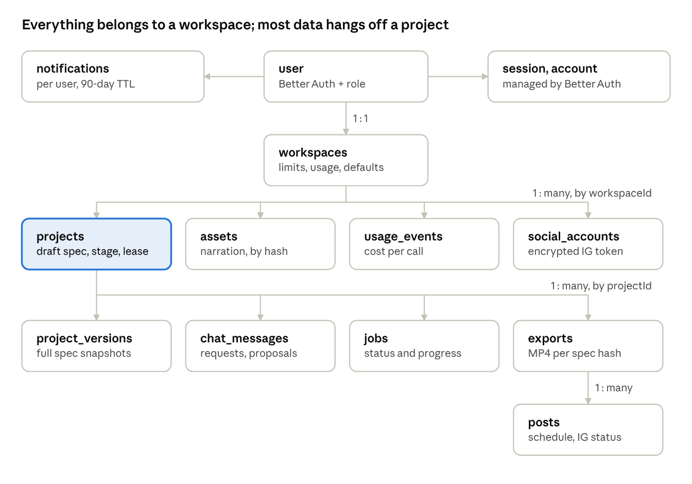

# Vidcosmos — Database Design (V1)

Nov 10, 2026 · @Rajwant Prajapati

## 1. Overview and conventions

Vidcosmos V1 stores all application data in one MongoDB Atlas database (`vidcosmos`) on AWS `ap-south-1` (Mumbai). It holds 20 collections: 5 managed by Better Auth and 15 owned by the app. Generated files live in Cloudflare R2; the database stores only their keys. This document expands Section 6 of the System Design and is the reference for the zod schemas in `packages/db`.

### Naming

| Item | Convention | Example |
| --- | --- | --- |
| App collections | `snake_case`, plural | `project_versions` |
| Better Auth collections | Better Auth's defaults | `user`, `session` |
| Fields | `camelCase` | `scheduledFor` |
| Enum values | Lowercase `snake_case` strings. Two exceptions: template names are camelCase identifiers (`barChart`), and values copied from an outside API keep its spelling (`IN_PROGRESS`) | `needs_reconnect` |
| References | `<entity>Id`, stored as `ObjectId` | `projectId` |
| R2 object keys | `<thing>Key`, or `key` inside a file object | `thumbnailKey`, `files.mp4.key` |
| Money | Integer micro-USD (`costMicroUsd`), never floats | 90000 = $0.09 |

### Rules that apply to every app collection

- **Ids:** `_id` is an `ObjectId`, created by the server. Scenes inside a spec use 10-character nanoids, because they must stay stable across versions.
- **Workspace scoping:** every document except Better Auth's and `migrations` carries `workspaceId`. Every query includes it, taken from the session. This is also the hook for teams in V2.
- **Timestamps:** `createdAt` and `updatedAt` are UTC `Date` values set by the server. Times shown to users are converted with `user.timeZone`.
- **Soft delete:** only `projects` are soft-deleted (`deletedAt`). Other collections are removed by the lifecycle jobs in Section 12.
- **Document version:** `schemaVersion` (an integer, starting at 1) on every app document lets migrations upgrade old shapes gradually (Section 13).
- **Validation:** zod schemas in `packages/db` are the source of truth. MongoDB `$jsonSchema` validators, generated from them, enforce required fields and types at the database (`validationLevel: moderate`, `validationAction: error`).
- **Size:** the largest document is a project holding its draft spec, at about 100 KB for a 90-second video. MongoDB's limit is 16 MB, and the API caps specs at 200 KB.

### Notation in this document

- `?` after a field name means optional.
- `[]` means an array.
- `{}` means an embedded object.
- Types are MongoDB BSON types: `ObjectId`, `string`, `int`, `double`, `bool`, `Date`, `object`, `array`.

## 2. Entity relationships

The data forms an ownership tree: a user owns one workspace, the workspace owns everything else, and most records belong to a project. Deleting a node deletes what hangs under it (Section 12).



Only ownership is drawn. Cross-references, such as a post pointing at its Instagram account or a version pointing at narration assets, are listed in the table below. Small collections not drawn: `verification` and `rateLimit` (Better Auth), `oauth_states`, `moderation_events`, `admin_audit`, `migrations`.

### Relationships

| From | To | Field | Cardinality | When the parent is deleted |
| --- | --- | --- | --- | --- |
| `user` | `workspaces` | `workspaces.ownerId` | 1 : 1 in V1 (1 : many with teams in V2) | Account deletion job deletes the workspace |
| `user` | `session`, `account` | `userId` | 1 : many | Better Auth deletes them |
| `user` | `notifications` | `userId` | 1 : many | Deleted with the user |
| `workspaces` | `projects`, `assets`, `jobs`, `exports`, `posts`, `social_accounts`, `usage_events`, `moderation_events` | `workspaceId` | 1 : many | Deleted by the account deletion job |
| `projects` | `project_versions`, `chat_messages`, `jobs`, `exports`, `posts` | `projectId` | 1 : many | Purged 30 days after soft delete |
| `projects` | `project_versions` | `projects.currentVersion` = `project_versions.number` | 1 : 1 (latest) | n/a |
| `projects` | `jobs` | `projects.activeJobId` | 1 : 0..1 (running job) | n/a |
| `project_versions` | `assets` | `spec.scenes[].timing.narrationAssetId` | many : many | Assets outlive versions; orphans removed after 30 days |
| `project_versions` | `chat_messages` | `chatMessageId` | many : 0..1 | Kept |
| `exports` | `project_versions` | `{projectId, versionNumber}` | many : 1 | Export kept until expiry |
| `exports` | `posts` | `posts.exportId` | 1 : many | Export kept while a scheduled post uses it |
| `social_accounts` | `posts` | `posts.socialAccountId` | 1 : many | Disconnect pauses scheduled posts |
| `jobs` | `chat_messages`, `exports` | `chat_messages.jobId`, `exports.jobId` | 1 : 0..1 | Kept |
| `usage_events` | `jobs`, `projects` | `jobId?`, `projectId?` | many : 1 | Kept for cost history |

MongoDB has no foreign keys, so these links are enforced by the app: ownership checks on read, and lifecycle jobs on delete.

## 3. Better Auth collections

Better Auth owns these five collections through its MongoDB adapter. The Better Auth CLI creates them and their indexes. The app adds fields to `user` only through `additionalFields`, and never writes to the other four directly.

### user

| Field | Type | Required | Notes |
| --- | --- | --- | --- |
| `_id` | ObjectId | yes |  |
| `name` | string | yes | 1 to 80 characters |
| `email` | string | yes | Lowercased, unique |
| `emailVerified` | boolean | yes | Email/password users must verify before generating |
| `image` | string | no | Google avatar URL |
| `role` | `user` or `admin` | yes | App field, default `user`, `input: false` so a client can never set it |
| `timeZone` | string | yes | App field, IANA name, default `Asia/Kolkata`. Used to show schedules |
| `locale` | `en` or `hi` | yes | App field, UI language, default `en` |
| `onboarding` | object | no | App field, see below |
| `onboardingSkippedAt` | Date | no | App field, written by the app (not Better Auth). Set when the user chooses "Skip for now"; the app stops sending them to onboarding |
| `status` | `active` or `deleting` | yes | App field. Set to `deleting` when account deletion starts; sign-in is refused |
| `lastActiveAt` | Date | no | App field, written at most once an hour |
| `createdAt`, `updatedAt` | Date | yes |  |

```ts
type Onboarding = {
  persona: 'creator' | 'educator' | 'brand' | 'other';
  topicArea?: string;            // up to 80 chars, e.g. "science for school students"
  language: 'en' | 'hi';         // copied into workspace defaults
  completedAt?: Date;            // unset while onboarding is unfinished
};
```

Until `onboarding.completedAt` or `onboardingSkippedAt` is set, every app page sends the user to onboarding. `onboarding`, `onboardingSkippedAt` and `notificationPrefs` are stored as plain objects and dates written by the app; Better Auth's additional fields cover only the scalar fields above.

One more app field, `notificationPrefs`, holds which events also send email: `{ email: { videoReady: boolean; posts: boolean; account: boolean } }`, all `true` by default. A hard bounce reported by Resend sets all three to `false`.

Indexes: `{ email: 1 }` unique (Better Auth).

### session

| Field | Type | Notes |
| --- | --- | --- |
| `_id` | ObjectId |  |
| `userId` | ObjectId | `user._id` |
| `token` | string | Unique. Stored in the `__Secure-` session cookie |
| `expiresAt` | Date | 30 days; extended at most once a day while in use |
| `ipAddress`, `userAgent` | string | For the sessions list and abuse review |
| `createdAt`, `updatedAt` | Date |  |

Indexes: `{ token: 1 }` unique, `{ userId: 1 }` (Better Auth). The app's first migration adds a TTL index `{ expiresAt: 1 }, expireAfterSeconds: 0` so expired sessions disappear.

### account

One row per sign-in method of a user.

| Field | Type | Notes |
| --- | --- | --- |
| `_id` | ObjectId |  |
| `userId` | ObjectId | `user._id` |
| `providerId` | `credential` or `google` |  |
| `accountId` | string | Google subject id, or the user id for `credential` |
| `password` | string | `credential` only. Hash written by Better Auth (scrypt) |
| `accessToken`, `refreshToken`, `idToken`, `accessTokenExpiresAt`, `scope` |  | `google` only. Vidcosmos asks for sign-in scopes only and never calls Google APIs with these |
| `createdAt`, `updatedAt` | Date |  |

Indexes: `{ userId: 1 }`, `{ providerId: 1, accountId: 1 }` unique.

Instagram connections are **not** stored here: they belong to a workspace, not to a sign-in, and live in `social_accounts` (Section 8).

### verification

Email verification and password reset tokens: `_id`, `identifier`, `value`, `expiresAt`, `createdAt`, `updatedAt`. The first migration adds a TTL index on `expiresAt`.

### rateLimit

Better Auth's own limiter for sign-in, sign-up and password reset, with storage set to `database`: `_id`, `key` (unique), `count`, `lastRequest` (epoch ms).

The app's API limiter (Section 10 of the SDD) keeps its counters in the same collection with keys prefixed `app:`, for example `app:{userId}:generate:{minute}`. Better Auth only reads keys it wrote. A TTL index on `expiresAt`, set only on `app:` rows, removes old windows.

## 4. Workspace and usage

### workspaces

The tenant boundary. Every app document carries a `workspaceId`, and every query filters on it. In V1 each user gets exactly one workspace, created in the same request as the user (a Better Auth `databaseHooks.user.create.after` hook). V2 teams add members without changing any other collection.

```ts
type Workspace = {
  _id: ObjectId;
  ownerId: ObjectId;                 // user._id, unique in V1
  name: string;                      // 1-60 chars, default "<first name>'s workspace"
  plan: 'free';                      // V2 adds paid plans and credits
  defaults: {
    format: VideoFormat;             // '9:16' unless the user picks another
    language: 'en' | 'hi';
    voiceGender: 'female' | 'male';
    tone: 'friendly' | 'professional' | 'energetic' | 'calm';
    audienceLevel: 'kids' | 'beginner' | 'intermediate' | 'expert';
    lengthSec: 30 | 60 | 90;
    palette: 'midnight' | 'paper' | 'ocean' | 'sunset';
    captionStyle: 'highlight' | 'classic' | 'none';
    musicTrackId: string | null;
  };
  limits: {                          // defaults below; an admin can change them per workspace
    videosPerMonth: number;          // 20
    revisionsPerVideo: number;       // 30 applied revisions per project
    generationsPerVideo: number;     // 50 AI calls per project (ideas, script, storyboard, scene retries)
    exportsPerDay: number;           // 20
    concurrentJobs: number;          // 2 queued or running jobs
  };
  usage: {
    periodKey: string;               // 'YYYY-MM' in IST, e.g. '2026-11'
    periodStart: Date;               // first instant of that month in IST, stored in UTC
    videosUsed: number;              // videos counted this period
    videosReserved: number;          // generations in flight that will count if they succeed
    exportsDayKey: string;           // 'YYYY-MM-DD' in IST
    exportsToday: number;
  };
  flags: {
    blocked: boolean;                // admin block: reads allowed, all AI work and posting refused
    blockedReason?: string;
    reviewReason?: string;           // set by repeated moderation blocks; admin looks at it
  };
  createdAt: Date;
  updatedAt: Date;
};
```

Indexes: `{ ownerId: 1 }` unique, `{ 'flags.blocked': 1 }` partial on `flags.blocked: true` (admin list).

**How a video is counted.** A video counts once, when its first full generation succeeds. Starting a generation reserves a slot; success commits it; failure or cancel releases it.

1. Reserve: one conditional update that also rolls the month over if needed (exact filter in Section 11). If it matches nothing, the API returns `LIMIT_REACHED`.
2. Commit, in a transaction with the version insert: `videosReserved -1`, `videosUsed +1`, and `projects.countedAt = now`.
3. Release: `videosReserved -1`. Jobs record `usage.reserved`, `usage.committed` and `usage.released`, so a retried step never moves the counters twice.

A project with `countedAt` set never reserves again: re-generating or revising it costs revisions, not videos. A sweeper releases reservations held by jobs that ended without releasing, so `videosReserved` cannot drift.

Concurrent jobs are not a counter. The API counts `jobs` with `status` in `queued` or `running` for the workspace, using a partial index, before creating a job.

### usage\_events

One row per paid or metered call. This is the cost record used for the admin cost view and for setting limits; it is never shown to users as a bill.

```ts
type UsageEvent = {
  _id: ObjectId;
  workspaceId: ObjectId;
  projectId?: ObjectId;
  jobId?: ObjectId;
  userId?: ObjectId;
  provider: 'gemini' | 'anthropic' | 'elevenlabs' | 'vercel_sandbox' | 'r2';
  operation: 'ideas' | 'script' | 'storyboard' | 'revise' | 'caption' | 'moderation'
           | 'narration' | 'render' | 'storage';
  model?: string;                    // e.g. 'gemini-3.8-flash', 'eleven_multilingual_v2'
  units: {
    inputTokens?: number;
    outputTokens?: number;           // includes thinking tokens, which are billed as output
    characters?: number;             // ElevenLabs
    sandboxSeconds?: number;
    bytes?: number;
  };
  cached: boolean;                   // true when the narration cache answered; cost 0
  costMicroUsd: number;              // integer, 1 USD = 1,000,000
  priceVersion: string;              // which price table produced costMicroUsd, e.g. '2026-11'
  attempt: number;                   // 1 for the first try, 2+ for retries
  createdAt: Date;
};
```

Indexes: `{ workspaceId: 1, createdAt: -1 }`, `{ provider: 1, createdAt: -1 }`, `{ jobId: 1 }` sparse, TTL `{ createdAt: 1 }` at 400 days.

Money is stored as integer micro-dollars so sums are exact. The free Gemini tier records real token counts with `costMicroUsd: 0`, which shows what the same traffic would cost on a paid tier.

### moderation\_events

Every moderation decision that blocked or flagged something, plus a 1% sample of allowed inputs for checking false negatives.

```ts
type ModerationEvent = {
  _id: ObjectId;
  workspaceId: ObjectId;
  userId: ObjectId;
  projectId?: ObjectId;
  inputKind: 'topic' | 'notes' | 'script' | 'scene_text' | 'chat' | 'caption';
  decision: 'allow' | 'block' | 'review';
  category?: 'sexual' | 'minors' | 'violence' | 'hate' | 'self_harm' | 'illegal' | 'misinformation' | 'other';
  reason?: string;                   // the model's short reason, up to 200 chars
  excerpt: string;                   // first 200 chars of the input
  model: string;
  createdAt: Date;
};
```

Indexes: `{ workspaceId: 1, createdAt: -1 }`, `{ decision: 1, createdAt: -1 }`, TTL `{ createdAt: 1 }` at 180 days. Three `block` decisions in 24 hours set `workspaces.flags.reviewReason`.

## 5. Projects, versions and chat

### projects

One video from idea to export. It holds everything the editor needs in one read: settings, the idea and script, and the working draft of the video spec.

```ts
type Project = {
  _id: ObjectId;
  workspaceId: ObjectId;
  createdBy: ObjectId;
  title: string;                       // 1-100 chars; starts as the topic, then the script title

  stage: 'draft' | 'generating' | 'ready' | 'revising' | 'failed';
  wizardStep: 'idea' | 'angles' | 'script' | 'storyboard' | 'video';  // where the editor reopens

  settings: {                          // copied from workspace defaults at creation
    format: VideoFormat;               // chosen in the idea step; later changes go through setFormat
    language: 'en' | 'hi';
    voiceGender: 'female' | 'male';
    voiceSpeed: number;                // 0.85-1.15, default 1
    tone: 'friendly' | 'professional' | 'energetic' | 'calm';
    audienceLevel: 'kids' | 'beginner' | 'intermediate' | 'expert';
    lengthSec: 30 | 60 | 90;
    palette: 'midnight' | 'paper' | 'ocean' | 'sunset';
    captionStyle: 'highlight' | 'classic' | 'none';
    musicTrackId: string | null;
  };

  idea: {
    topic: string;                     // 3-500 chars
    notes?: string;                    // up to 5,000 chars of the user's own material
    goal?: 'explain' | 'teach' | 'summarise' | 'promote';
    angles: Array<{ id: string; title: string; hook: string; outline: string[] }>;  // 3-5 from the ideas step
    selectedAngleId?: string;
  };

  script: {
    title: string;
    hook: string;                      // first sentence
    text: string;                      // full narration, up to 1,800 chars
    wordCount: number;
    estDurationSec: number;            // wordCount / words per second (en 2.5, hi 2.2)
    source: 'ai' | 'user' | 'ai_edited';
    updatedAt: Date;
  } | null;

  draft: {
    spec: VideoSpec | null;            // Section 6; null until the storyboard exists
    rev: number;                       // +1 on every write; the client sends it back
    updatedAt: Date;
    updatedBy: ObjectId;
  };

  currentVersion: number | null;       // latest project_versions.number
  countedAt: Date | null;              // when this video counted against the monthly limit
  revisionsUsed: number;               // applied revisions, against limits.revisionsPerVideo
  generationsUsed: number;             // AI calls, against limits.generationsPerVideo

  stageHashes: {                       // detects stale downstream steps
    idea?: string;                     // hash of topic + notes + angle the script was written from
    script?: string;                   // hash of the script the storyboard was made from
  };

  activeJobId: ObjectId | null;        // the one running job that changes this project
  lease: {                             // who is editing; see Section 11
    holderSessionId: string;
    userId: ObjectId;
    expiresAt: Date;                   // now + 60 s, renewed every 30 s
  } | null;

  thumbnailKey: string | null;         // R2 key of a frame of the title scene
  lastExportId: ObjectId | null;
  lastOpenedAt: Date;
  createdAt: Date;
  updatedAt: Date;
  deletedAt: Date | null;              // soft delete; purged 30 days later
};
```

**Stages.** `draft` until the first generation starts. `generating` while the first full generation runs; `ready` when a version exists and nothing is running; `revising` while a revision job runs; `failed` when the first generation fails with nothing to show. A failed revision returns the project to `ready`, because the previous version still plays.

**Stale steps.** When the user edits the script after a storyboard exists, `hash(script) != stageHashes.script`, so the editor shows "Script changed. Rebuild the storyboard?" instead of silently regenerating.

| Index | Serves |
| --- | --- |
| `{ workspaceId: 1, deletedAt: 1, updatedAt: -1 }` | Library, newest first |
| `{ workspaceId: 1, deletedAt: 1, stage: 1, updatedAt: -1 }` | Library filtered by status |
| `{ deletedAt: 1 }` partial on `deletedAt` existing and not null | Purge job |
| Atlas Search index `projects_search` on `title`, `idea.topic` | Library search |

If Atlas Search is unavailable, library search falls back to a case-insensitive prefix match on `title`, which uses the first index.

### project\_versions

A full snapshot of the spec each time the video changes: after generation, after an applied revision, after a manual save, after a restore. Restoring copies an old snapshot into a new version, so history only grows.

```ts
type ProjectVersion = {
  _id: ObjectId;
  workspaceId: ObjectId;
  projectId: ObjectId;
  number: number;                      // 1, 2, 3 ... per project
  spec: VideoSpec;                     // complete, with timing
  specHash: string;                    // sha256 of canonical JSON, the export cache key
  reason: 'generate' | 'apply' | 'manual' | 'restore';
  summary: string;                     // up to 200 chars, e.g. "Shorter intro; scene 3 now a timeline"
  restoredFrom?: number;
  chatMessageId?: ObjectId;            // the proposal that produced it
  jobId?: ObjectId;
  durationMs: number;
  sceneCount: number;
  createdBy: ObjectId;
  createdAt: Date;
};
```

Indexes: `{ projectId: 1, number: -1 }` unique. The unique index makes a duplicate insert from a retried step fail harmlessly.

The latest 50 versions per project are kept. After each insert, versions with `number <= current - 50` are deleted. Exports do not depend on versions being kept: an export keeps its own `specHash` and files.

### chat\_messages

The revision conversation for a project. A request from the user, the assistant's reply, and the proposal it makes are all messages.

```ts
type ChatMessage = {
  _id: ObjectId;
  workspaceId: ObjectId;
  projectId: ObjectId;
  role: 'user' | 'assistant';
  content: string;                     // user: up to 2,000 chars
  scope: { kind: 'video' } | { kind: 'scene'; sceneId: string };
  kind: 'message' | 'proposal' | 'clarify' | 'unsupported' | 'error';
  proposal?: {
    summary: string;                   // what will change, in one or two sentences
    operations: RevisionOperation[];
    affectedSceneIds: string[];
    regeneratesVoice: boolean;         // true if any narration changes
    estDurationSec: number;            // new video length
    warnings: string[];                // e.g. "Video will be 94 s, above your 90 s target"
    baseRev: number;                   // draft.rev the proposal was computed from
  };
  status?: 'proposed' | 'applied' | 'dismissed' | 'stale' | 'failed';   // proposals only
  appliedVersion?: number;
  jobId?: ObjectId;
  error?: { code: string; message: string };
  createdBy?: ObjectId;                // set on user messages
  createdAt: Date;
  updatedAt: Date;
};
```

Revisions are typed operations, not raw JSON patches, so they can be validated, shown to the user, and applied to a spec that has moved on:

```ts
type RevisionOperation =
  | { op: 'updateScene'; sceneId: string; narration?: string; content?: Partial<SceneContent>; template?: TemplateName }
  | { op: 'addScene'; afterSceneId: string | null; scene: SceneInput }     // null = first
  | { op: 'removeScene'; sceneId: string }
  | { op: 'moveScene'; sceneId: string; afterSceneId: string | null }
  | { op: 'setFormat'; format: VideoFormat }                              // layouts switch, narration and audio kept
  | { op: 'setTheme'; palette?: Palette; captionStyle?: CaptionStyle }
  | { op: 'setVoice'; gender?: 'female' | 'male'; speed?: number }
  | { op: 'setMusic'; trackId: string | null; volume?: number }
  | { op: 'rewriteAll'; spec: VideoSpecInput };                           // whole-video rewrite
```

**Staleness.** On apply, if `draft.rev != proposal.baseRev`, the server re-checks each operation against the current draft. Operations that still apply (their scene exists and wasn't edited since) go ahead; if any conflict, the proposal becomes `stale` and the user is asked to send the request again.

Indexes: `{ projectId: 1, createdAt: -1 }`, `{ projectId: 1, status: 1 }` partial on `status: 'proposed'`. Messages live as long as their project.

## 6. The VideoSpec (embedded)

The VideoSpec is the video. The Remotion Player plays it live in the editor, the renderer turns it into an MP4, and revisions edit it. It is stored embedded in `projects.draft.spec` and in each `project_versions.spec`, never as its own collection. Its zod schema in `packages/spec` is the one definition used by the API, the pipeline, the LLM prompts and Remotion.

```ts
type VideoFormat = '9:16' | '16:9' | '1:1';   // canvas shape; see Formats below

type VideoSpec = {
  version: 1;                          // schema version; see Section 13 for migrations
  format: VideoFormat;                 // missing in prototype specs: read as '9:16'
  title: string;                       // 1-100 chars
  language: 'en' | 'hi';
  voice: {
    gender: 'female' | 'male';
    voiceId: string;                   // ElevenLabs voice id
    model: 'eleven_multilingual_v2';
    speed: number;                     // 0.85-1.15
  };
  theme: {
    palette: 'midnight' | 'paper' | 'ocean' | 'sunset';
    captionStyle: 'highlight' | 'classic' | 'none';
  };
  music: { trackId: string; volume: number; duck: boolean } | null;  // volume 0-1; ducked x0.25 under speech
  scenes: Scene[];                     // 2-10
};

type Scene = SceneBase & SceneContent;  // discriminated on `template`

type SceneBase = {
  id: string;                          // 'sc_' + 8 random chars; stable across revisions
  template: TemplateName;
  narration: string;                   // 1-400 chars, what the narrator says in this scene
  userEdited: boolean;                 // true once the user edits it by hand; whole-video rewrites ask before replacing it
  timing: SceneTiming | null;          // null until narration is synthesised
};

type SceneTiming = {
  narrationAssetId: ObjectId;          // assets._id, never a URL
  narrationHash: string;               // sha256(narration, language, voiceId, model, speed)
  audioDurationMs: number;
  leadInMs: number;                    // 300
  durationMs: number;                  // leadIn + audio + 400 ms tail
  words: Array<{ text: string; startMs: number; endMs: number }>;
  timingSource: 'provider' | 'estimated';  // 'estimated' only for the dev voice
};

type Trigger = {
  trigger: string;                     // words copied from this scene's narration
  atMs?: number;                       // filled by the pipeline from word timings; not written by the LLM
};
```

The voice and the narration together fix the audio, so `narrationHash` decides whether a scene needs new audio. A revision that changes only the theme or an on-screen label keeps every hash, so no voice is regenerated.

### Formats

Every video has one of three formats, chosen in the idea step and stored in the spec. Because `format` is in the spec, `specHash` changes with it, every version records the shape it was made in, and exports of different formats never share a cache entry.

| Format | Canvas at 1080p (px) | Canvas at 720p (px) | Safe area (kept clear of text) | Typical use |
| --- | --- | --- | --- | --- |
| 9:16 (default) | 1080 x 1920 | 720 x 1280 | Top 14%, bottom 20%, sides 6% (Instagram and Shorts buttons) | Reels, Shorts, Stories |
| 16:9 | 1920 x 1080 | 1280 x 720 | 5% on every side | YouTube, websites, talks |
| 1:1 | 1080 x 1080 | 720 x 720 | 5% on every side | Feed posts, LinkedIn |

Each template has one layout per format: a flowchart runs top to bottom in 9:16 and left to right in 16:9, and a comparison stacks in 9:16 and sits side by side in 16:9 and 1:1. The LLM writes the same scene content whatever the format, and the text limits below are the same for all three, so a `setFormat` revision never makes a valid scene invalid. `setFormat` keeps narration and audio (`narrationHash` does not include the format) and only changes layout, so it costs no voice or AI calls.

### Templates

Every visual element on screen has a trigger, so it appears as the narrator says it. Limits keep text readable at every format's canvas size inside its safe area (Formats, above); they were set on 9:16, the narrowest canvas.

| Template | Content fields (each element also has a `Trigger`) | Limits |
| --- | --- | --- |
| `title` | `heading`, `subheading?`, `icon?` | Heading up to 60 chars |
| `bullets` | `heading`, `items[]: { text, icon? }` | 2-5 items, 60 chars each |
| `keyTerm` | `term`, `definition`, `icon?` | Term 40, definition 140 chars |
| `flowchart` | `heading`, `layout: 'linear' or 'cycle'`, `steps[]: { label, icon? }` | 3-6 steps, 28 chars each |
| `comparison` | `heading`, `left` and `right`: `{ title, icon?, points[] }` | 2-4 points a side |
| `timeline` | `heading`, `events[]: { date, label }` | 3-6 events; date 16, label 40 chars |
| `barChart` | `heading`, `unit?`, `bars[]: { label, value }`, `source?` | 2-6 bars, values 0 or more |
| `pieChart` | `heading`, `slices[]: { label, value }`, `source?` | 2-5 slices; shown as percentages |
| `iconGrid` | `heading`, `items[]: { icon, label }` | 4-6 items, 24 chars each |
| `statCallout` | `value`, `label`, `icon?`, `source?` | Value 12 chars (e.g. "72%"), label 80 |
| `quiz` | `question`, `options[]: { text }`, `answerIndex`, `reveal: Trigger` | 2-4 options |
| `recap` | `heading`, `points[]: { text }`, `cta?` | 2-4 points |

`title`, `bullets`, `flowchart` and `comparison` are built and tested in the prototype. The other eight are specified here and built in V1. `icon` is a name from the closed list of about 100 Lucide icons in `packages/spec/icons.ts`, so the LLM cannot ask for an icon that doesn't exist. Illustrations are V2.

### Rules checked on every write

zod checks shape and limits. These semantic checks run after it, on the server, for the LLM's output and for the user's edits alike:

- Each trigger's words appear in its scene's narration, in order across the scene.
- The narration of all scenes together reproduces the approved script (at least 95% of its words, at most 5% extra), on generation only.
- Scene ids are unique within the spec.
- Total `durationMs` is between 20 s and 100 s once timing exists.
- `timing.narrationHash` matches the scene's current narration and voice; if not, `timing` is cleared and the scene is marked for new audio.

`specHash` is the sha256 of the spec serialised with sorted keys. It covers everything that changes a single frame, so two specs with the same hash render the same MP4.

## 7. Jobs, assets and exports

### jobs

The user-visible record of background work. Inngest runs the work; this document is what the UI polls and what support looks at. One job per user action.

```ts
type Job = {
  _id: ObjectId;
  workspaceId: ObjectId;
  projectId: ObjectId | null;          // null for account-level jobs
  userId: ObjectId;
  type: 'ideas' | 'script' | 'script_rewrite' | 'storyboard' | 'generate' | 'scene_retry'
      | 'revise_propose' | 'revise_apply' | 'export' | 'caption' | 'publish' | 'account_delete';
  status: 'queued' | 'running' | 'succeeded' | 'partial' | 'failed' | 'cancelled';
  stage?: 'moderation' | 'llm' | 'validate' | 'narration' | 'timing' | 'save'
        | 'render' | 'upload' | 'ig_container' | 'ig_processing' | 'ig_publish';
  progress: number;                    // 0-100, monotonic
  message?: string;                    // user-facing, e.g. "Recording narration (4 of 7 scenes)"
  scenes?: Array<{                     // generate, revise_apply, scene_retry
    sceneId: string;
    status: 'pending' | 'running' | 'done' | 'failed' | 'skipped';  // skipped = audio reused from cache
    attempts: number;
    error?: { code: string; message: string };
  }>;
  input: Record<string, unknown>;      // small, type-specific, validated per type (no specs)
  result?: Record<string, unknown>;    // e.g. { versionNumber: 4 } or { exportId }
  error?: { code: string; message: string; retryable: boolean; stage?: string };
  idempotencyKey?: string;             // from the Idempotency-Key header
  inngest: { eventId: string; runId?: string };
  usage: { reserved: boolean; committed: boolean; released: boolean };
  attempts: number;
  cancelRequestedAt?: Date;
  heartbeatAt?: Date;                  // written by each step; the sweeper looks for silent jobs
  startedAt?: Date;
  finishedAt?: Date;
  expiresAt?: Date;                    // finishedAt + 180 days (TTL)
  createdAt: Date;
  updatedAt: Date;
};
```

**Status transitions.** `queued` to `running` to `succeeded`, `partial`, `failed` or `cancelled`; `queued` can also go straight to `cancelled`. Finished states never change again; a retry is a new job. Every write from a step is conditional on `status: 'running'`, so a step that runs late after a cancel changes nothing.

`partial` is for generation where some scenes failed after retries: the video is saved with those scenes marked, and the user can retry just them (`scene_retry`).

| Index | Serves |
| --- | --- |
| `{ workspaceId: 1, status: 1 }` partial on `status` in `queued`, `running` | Concurrent job limit |
| `{ projectId: 1, createdAt: -1 }` | Project activity, latest job |
| `{ workspaceId: 1, idempotencyKey: 1 }` unique, partial on `idempotencyKey` existing | Idempotent requests |
| `{ status: 1, heartbeatAt: 1 }` partial on `status: 'running'` | Stuck-job sweeper |
| `{ expiresAt: 1 }` TTL | Cleanup |

### assets

Files the app produced and will reuse. In V1 that is narration audio only; V2 adds music uploads and illustrations. The bytes live in R2; this document says what they are.

```ts
type Asset = {
  _id: ObjectId;
  workspaceId: ObjectId;
  kind: 'narration';
  hash: string;                        // narrationHash, see Section 6
  r2Key: string;                       // ws/{workspaceId}/narration/{hash}.mp3
  mime: 'audio/mpeg';
  bytes: number;
  durationMs: number;
  meta: {
    text: string;
    language: 'en' | 'hi';
    voiceId: string;
    model: string;
    speed: number;
    characters: number;                // billed characters
    words: Array<{ text: string; startMs: number; endMs: number }>;
  };
  createdAt: Date;
  lastUsedAt: Date;                    // bumped when a spec starts using it
};
```

Indexes: `{ workspaceId: 1, kind: 1, hash: 1 }` unique, `{ lastUsedAt: 1 }`.

The unique index is the narration cache. Before calling ElevenLabs, the pipeline looks up the hash; on a hit it copies `meta.words` into the scene's timing and pays nothing. Two parallel steps synthesising the same text race on the insert: the loser gets a duplicate-key error, reads the winner's asset, and deletes its own R2 object. The cache is per workspace on purpose, so deleting an account deletes all of its audio.

### exports

One rendered MP4 of one spec at one resolution.

```ts
type Export = {
  _id: ObjectId;
  workspaceId: ObjectId;
  projectId: ObjectId;
  versionNumber: number;
  specHash: string;
  format: VideoFormat;                 // copied from the spec
  resolution: '1080p' | '720p';        // short side: 1080 or 720 px
  width: number;                       // e.g. 1080 x 1920 for 9:16 at 1080p
  height: number;
  status: 'queued' | 'rendering' | 'uploading' | 'ready' | 'failed' | 'expired';
  active: boolean;                     // false once failed or expired
  jobId: ObjectId;
  files: {
    mp4?: { key: string; bytes: number };   // ws/{wsId}/exports/{exportId}/video.mp4
    mp3?: { key: string; bytes: number };   // narration + music mix, for download
    cover?: { key: string; atMs: number };  // JPEG frame used as the Reel cover
    srt?: { key: string };                  // captions file
  };
  durationMs: number;
  render?: { setupMs: number; renderMs: number; uploadMs: number };
  captionDraft?: string;               // AI-written Instagram caption, editable before posting
  error?: { code: string; message: string };
  downloadCount: number;
  createdBy: ObjectId;
  createdAt: Date;
  readyAt?: Date;
  expiresAt?: Date;                    // readyAt + 30 days, pushed out while a post needs it
};
```

Indexes: `{ projectId: 1, specHash: 1, resolution: 1 }` unique, partial on `active: true`; `{ projectId: 1, createdAt: -1 }`; `{ status: 1, expiresAt: 1 }` partial on `status: 'ready'`.

The partial unique index is the render cache. Exporting a spec that already has an active export returns that export (ready or still rendering) instead of rendering again. When an export fails or expires it becomes inactive, so a new one can take its place.

**R2 layout.** The bucket is private; the app hands out presigned URLs that last 15 minutes for downloads and playback, and 6 hours for the URL given to Instagram.

```
ws/{workspaceId}/narration/{hash}.mp3
ws/{workspaceId}/exports/{exportId}/video.mp4  audio.mp3  cover.jpg  captions.srt
ws/{workspaceId}/thumbs/{projectId}.jpg
```

Everything for a workspace sits under one prefix, so account deletion is one prefix delete.

## 8. Publishing

### social\_accounts

An Instagram professional account connected to a workspace through Instagram API with Instagram Login. V1 allows one connected Instagram account per workspace.

```ts
type SocialAccount = {
  _id: ObjectId;
  workspaceId: ObjectId;
  connectedBy: ObjectId;
  platform: 'instagram';
  igUserId: string;                    // Instagram professional account id
  username: string;
  accountType: 'BUSINESS' | 'MEDIA_CREATOR';
  profilePictureUrl?: string;          // refreshed on each token refresh; may expire
  token: {                             // long-lived access token, encrypted (Section 13)
    ciphertext: string;                // base64, AES-256-GCM
    iv: string;
    tag: string;
    keyVersion: number;
  };
  tokenExpiresAt: Date;                // about 60 days after issue or refresh
  tokenRefreshedAt: Date;
  scopes: string[];                    // instagram_business_basic, instagram_business_content_publish
  status: 'connected' | 'expiring' | 'revoked' | 'disconnected';
  active: boolean;                     // false once disconnected
  lastError?: { code: string; message: string; at: Date };
  publishQuota?: { used: number; checkedAt: Date };  // from content_publishing_limit
  connectedAt: Date;
  disconnectedAt?: Date;
  createdAt: Date;
  updatedAt: Date;
};
```

| Index | Serves |
| --- | --- |
| `{ workspaceId: 1, platform: 1 }` unique, partial on `active: true` | One live connection per workspace |
| `{ status: 1, tokenExpiresAt: 1 }` partial on `active: true` | Daily token refresh cron |
| `{ igUserId: 1 }` | Detecting the same Instagram account on two workspaces |

**Token lifecycle.** A daily cron refreshes tokens that expire within 10 days and are at least 24 hours old (Instagram refuses younger ones). A failed refresh sets `expiring` and emails the user when fewer than 7 days are left. An API error saying the token is invalid sets `revoked`; scheduled posts on that account become `needs_reconnect`. Disconnecting deletes the token ciphertext, sets `active: false`, and keeps the row so past posts still show which account they went to.

### oauth\_states

The `state` value of an Instagram connect flow, so the callback can prove it started here.

```ts
type OAuthState = {
  _id: ObjectId;
  stateHash: string;                   // sha256 of the random state sent to Instagram
  userId: ObjectId;
  workspaceId: ObjectId;
  platform: 'instagram';
  returnTo: string;                    // app path only, e.g. '/settings/integrations'
  createdAt: Date;
  expiresAt: Date;                     // 10 minutes
};
```

Indexes: `{ stateHash: 1 }` unique, TTL `{ expiresAt: 1 }`. The callback deletes the row with `findOneAndDelete`, so a state works once. Only the hash is stored, so a database read cannot be used to forge a callback.

### posts

One Reel sent, or to be sent, to Instagram.

Any format can be posted as a Reel. Instagram accepts aspect ratios from 0.01:1 to 10:1 but recommends 9:16, so 16:9 and 1:1 Reels show with blank space or cropping; the Export screen says so before a non-9:16 post is scheduled.

```ts
type Post = {
  _id: ObjectId;
  workspaceId: ObjectId;
  projectId: ObjectId;
  exportId: ObjectId;
  socialAccountId: ObjectId;
  createdBy: ObjectId;
  caption: string;                     // up to 2,200 chars, at most 30 hashtags (Instagram limits)
  coverAtMs?: number;                  // frame used for cover_url
  shareToFeed: boolean;
  scheduledFor: Date | null;           // null = post now
  timeZone: string;                    // what the user picked the time in, for display
  status: 'scheduled' | 'uploading' | 'processing' | 'published' | 'failed'
        | 'missed' | 'needs_reconnect' | 'cancelled';
  attempts: number;
  inngestEventId: string;
  ig: {
    containerId?: string;
    containerStatus?: 'IN_PROGRESS' | 'FINISHED' | 'ERROR' | 'EXPIRED' | 'PUBLISHED';
    mediaId?: string;
    permalink?: string;
  };
  error?: { code: string; message: string; igCode?: number; igSubcode?: number };
  publishedAt?: Date;
  cancelledAt?: Date;
  createdAt: Date;
  updatedAt: Date;
};
```

| Index | Serves |
| --- | --- |
| `{ workspaceId: 1, scheduledFor: 1 }` | Calendar and upcoming posts |
| `{ projectId: 1, createdAt: -1 }` | Posts of a video |
| `{ status: 1, scheduledFor: 1 }` partial on `status` in `scheduled`, `uploading`, `processing` | Reconciliation cron every 15 minutes |
| `{ socialAccountId: 1, status: 1 }` | Pausing posts when an account is revoked |
| `{ exportId: 1 }` | Keeping an export while a post needs it |

**Status flow.** `scheduled` to `uploading` (container created with the presigned MP4 URL) to `processing` (polling the container's `status_code`) to `published`. Failure paths:

- `failed`: the container returned `ERROR`, or retries ran out. `error` holds Instagram's code.
- `needs_reconnect`: the token was revoked or expired before posting. Reconnecting moves the post back to `scheduled` if its time hasn't passed by more than 6 hours.
- `missed`: the reconciliation cron found a scheduled post more than 6 hours late (for example after an outage). It is not posted automatically; the user can post it now or reschedule.
- `cancelled`: the user cancelled before it reached `uploading`. A post in `uploading` or `processing` cannot be cancelled, because Instagram may publish it anyway.

Scheduling a post sets the export's `expiresAt` to at least `scheduledFor + 7 days`, so the file still exists when Instagram fetches it.

## 9. System collections

### notifications

In-app notifications (the bell). The same events also send email through Resend where the user has it turned on; `emailedAt` records that.

```ts
type Notification = {
  _id: ObjectId;
  userId: ObjectId;
  workspaceId: ObjectId;
  type: 'video_ready' | 'generation_failed' | 'export_ready' | 'export_failed'
      | 'post_published' | 'post_failed' | 'post_missed' | 'account_expiring'
      | 'account_revoked' | 'limit_near' | 'limit_reached';
  title: string;                       // up to 80 chars
  body: string;                        // up to 240 chars
  link: string;                        // app path, e.g. '/projects/{id}'
  entity?: { kind: 'project' | 'export' | 'post' | 'social_account'; id: ObjectId };
  dedupeKey: string;                   // e.g. 'post_failed:{postId}', so retries don't notify twice
  readAt: Date | null;
  emailedAt?: Date;
  createdAt: Date;
};
```

Indexes: `{ userId: 1, readAt: 1, createdAt: -1 }` (unread badge and list), `{ userId: 1, dedupeKey: 1 }` unique, TTL `{ createdAt: 1 }` at 90 days.

### admin\_audit

Every action taken in the admin console. Rows are only ever inserted.

```ts
type AdminAudit = {
  _id: ObjectId;
  actorId: ObjectId;                   // the admin
  action: 'workspace.block' | 'workspace.unblock' | 'limits.update' | 'job.retry'
        | 'job.cancel' | 'user.delete' | 'post.cancel' | 'moderation.clear';
  target: { kind: 'user' | 'workspace' | 'project' | 'job' | 'post'; id: ObjectId };
  before?: Record<string, unknown>;    // changed fields only
  after?: Record<string, unknown>;
  reason: string;                      // required, up to 500 chars
  ip: string;
  createdAt: Date;
};
```

Indexes: `{ 'target.id': 1, createdAt: -1 }`, `{ actorId: 1, createdAt: -1 }`. Kept for 2 years. The app's database user has no `update` or `delete` grant on this collection (Section 13).

### migrations

Which migrations have run (Section 13).

```ts
type Migration =
  | { _id: string; name: string; checksum: string; appliedAt: Date; durationMs: number }  // _id like '0003-add-posts-indexes'
  | { _id: 'lock'; holder: string; expiresAt: Date };  // held while a migration runs
```

## 10. Indexes and query patterns

All indexes are declared in `packages/db/indexes.ts` and created by migrations, never by the app at startup. Each one exists for a named query below; an index without a query is removed.

### Index catalogue (app collections)

| Collection | Keys | Options |
| --- | --- | --- |
| `workspaces` | `{ ownerId: 1 }` | unique |
| `workspaces` | `{ 'flags.blocked': 1 }` | partial `{ 'flags.blocked': true }` |
| `projects` | `{ workspaceId: 1, deletedAt: 1, updatedAt: -1 }` |  |
| `projects` | `{ workspaceId: 1, deletedAt: 1, stage: 1, updatedAt: -1 }` |  |
| `projects` | `{ deletedAt: 1 }` | partial `{ deletedAt: { $type: 'date' } }` |
| `projects` | Atlas Search `projects_search` on `title`, `idea.topic` | `workspaceId` as a filter field |
| `project_versions` | `{ projectId: 1, number: -1 }` | unique |
| `chat_messages` | `{ projectId: 1, createdAt: -1 }` |  |
| `chat_messages` | `{ projectId: 1, status: 1 }` | partial `{ status: 'proposed' }` |
| `jobs` | `{ workspaceId: 1, status: 1 }` | partial `{ status: { $in: ['queued', 'running'] } }` |
| `jobs` | `{ projectId: 1, createdAt: -1 }` |  |
| `jobs` | `{ workspaceId: 1, idempotencyKey: 1 }` | unique, partial `{ idempotencyKey: { $exists: true } }` |
| `jobs` | `{ status: 1, heartbeatAt: 1 }` | partial `{ status: 'running' }` |
| `jobs` | `{ expiresAt: 1 }` | TTL 0 |
| `assets` | `{ workspaceId: 1, kind: 1, hash: 1 }` | unique |
| `assets` | `{ lastUsedAt: 1 }` |  |
| `exports` | `{ projectId: 1, specHash: 1, resolution: 1 }` | unique, partial `{ active: true }` |
| `exports` | `{ projectId: 1, createdAt: -1 }` |  |
| `exports` | `{ status: 1, expiresAt: 1 }` | partial `{ status: 'ready' }` |
| `social_accounts` | `{ workspaceId: 1, platform: 1 }` | unique, partial `{ active: true }` |
| `social_accounts` | `{ status: 1, tokenExpiresAt: 1 }` | partial `{ active: true }` |
| `social_accounts` | `{ igUserId: 1 }` |  |
| `oauth_states` | `{ stateHash: 1 }` | unique |
| `oauth_states` | `{ expiresAt: 1 }` | TTL 0 |
| `posts` | `{ workspaceId: 1, scheduledFor: 1 }` |  |
| `posts` | `{ projectId: 1, createdAt: -1 }` |  |
| `posts` | `{ status: 1, scheduledFor: 1 }` | partial `{ status: { $in: ['scheduled', 'uploading', 'processing'] } }` |
| `posts` | `{ socialAccountId: 1, status: 1 }` |  |
| `posts` | `{ exportId: 1 }` |  |
| `usage_events` | `{ workspaceId: 1, createdAt: -1 }` |  |
| `usage_events` | `{ provider: 1, createdAt: -1 }` |  |
| `usage_events` | `{ jobId: 1 }` | sparse |
| `usage_events` | `{ createdAt: 1 }` | TTL 400 days |
| `moderation_events` | `{ workspaceId: 1, createdAt: -1 }`, `{ decision: 1, createdAt: -1 }` |  |
| `moderation_events` | `{ createdAt: 1 }` | TTL 180 days |
| `notifications` | `{ userId: 1, readAt: 1, createdAt: -1 }` |  |
| `notifications` | `{ userId: 1, dedupeKey: 1 }` | unique |
| `notifications` | `{ createdAt: 1 }` | TTL 90 days |
| `admin_audit` | `{ 'target.id': 1, createdAt: -1 }`, `{ actorId: 1, createdAt: -1 }` |  |
| `admin_audit` | `{ createdAt: 1 }` | TTL 730 days |
| `rateLimit` (app rows) | `{ expiresAt: 1 }` | TTL 0 |
| `session`, `verification` | `{ expiresAt: 1 }` | TTL 0, added by the app |

Partial filters with `$in` need MongoDB 6.0 or later; Atlas runs 7.0 or 8.0.

### Query patterns

The queries the product runs most, and the index each one uses. Every app query includes `workspaceId` or a parent id already checked against it.

| Screen or job | Query | Index |
| --- | --- | --- |
| Library | `projects.find({ workspaceId, deletedAt: null }).sort({ updatedAt: -1 }).limit(24)`, cursor on `updatedAt` + `_id` | projects 1 |
| Library, filtered | same plus `stage` | projects 2 |
| Open editor | `projects.findOne({ _id, workspaceId })` | `_id` |
| Version history | `project_versions.find({ projectId }, { spec: 0 }).sort({ number: -1 })` | project\_versions 1 |
| Chat panel | `chat_messages.find({ projectId }).sort({ createdAt: -1 }).limit(50)` | chat 1 |
| Job polling (every 2 s) | `jobs.findOne({ _id, workspaceId }, { input: 0 })` | `_id` |
| Concurrency check | `jobs.countDocuments({ workspaceId, status: { $in: ['queued', 'running'] } })` | jobs 1 |
| Narration cache | `assets.findOne({ workspaceId, kind: 'narration', hash })` | assets 1 |
| Export cache | `exports.findOne({ projectId, specHash, resolution, active: true })` | exports 1 |
| Calendar | `posts.find({ workspaceId, scheduledFor: { $gte, $lt } })` | posts 1 |
| Reconcile cron | `posts.find({ status: 'scheduled', scheduledFor: { $lte: now } })` | posts 3 |
| Token refresh cron | `social_accounts.find({ active: true, status: { $in: ['connected', 'expiring'] }, tokenExpiresAt: { $lte: now + 10d } })` | social 2 |
| Stuck-job sweeper | `jobs.find({ status: 'running', heartbeatAt: { $lt: now - 10min } })` | jobs 4 |
| Bell badge | `notifications.countDocuments({ userId, readAt: null })` | notifications 1 |
| Admin cost view | `usage_events.aggregate([{ $match: { createdAt: { $gte } } }, { $group: { _id: '$provider', micro: { $sum: '$costMicroUsd' } } }])` | usage 2 |

Lists use cursor pagination on `(sortField, _id)`, never `skip`. The version list leaves out `spec`, which is most of each document.

## 11. Consistency and concurrency

MongoDB gives atomic updates on one document. Vidcosmos keeps each rule that must never break inside one document where it can, uses conditional updates to make writes safe under races, and uses a transaction only where two collections must change together. All writes use write concern `majority`.

### Draft autosave (optimistic concurrency)

The editor sends the `rev` it last saw. The write only matches if nobody else has written since and this session holds the lease:

```ts
projects.updateOne(
  { _id, workspaceId, 'draft.rev': baseRev, 'lease.holderSessionId': sessionId, deletedAt: null },
  { $set: { 'draft.spec': spec, 'draft.updatedAt': now, 'draft.updatedBy': userId, updatedAt: now },
    $inc: { 'draft.rev': 1 } }
);
// matchedCount 0 -> the API reads the project and returns 409 REV_CONFLICT or 423 LEASE_HELD
```

### Edit lease (one editor at a time)

A second tab or device can watch but not edit. Acquiring or renewing:

```ts
projects.updateOne(
  { _id, workspaceId,
    $or: [ { lease: null }, { 'lease.expiresAt': { $lt: now } }, { 'lease.holderSessionId': sessionId } ] },
  { $set: { lease: { holderSessionId: sessionId, userId, expiresAt: now + 60s } } }
);
```

The editor renews every 30 seconds. "Take over editing" in another tab sets the lease unconditionally after the user confirms; the old tab's next save fails with `LEASE_HELD` and it switches to read-only.

### One running job per project

```ts
projects.updateOne(
  { _id, workspaceId, activeJobId: null },
  { $set: { activeJobId: jobId, stage: 'generating' } }   // or 'revising'
);
// no match -> 409 JOB_IN_PROGRESS with the running job's id
```

The job's final step clears `activeJobId` with a filter on `activeJobId: jobId`, so it cannot clear a newer job's claim. The stuck-job sweeper clears it for jobs that died.

### Usage reservation, with the month rollover

One update both starts a new month when needed and checks the limit, so two requests at midnight cannot both get the last slot:

```ts
workspaces.updateOne(
  { _id: workspaceId, 'flags.blocked': false,
    $expr: { $or: [
      { $ne: ['$usage.periodKey', periodKey] },
      { $lt: [{ $add: ['$usage.videosUsed', '$usage.videosReserved'] }, '$limits.videosPerMonth'] } ] } },
  [ { $set: { usage: { $cond: [
      { $ne: ['$usage.periodKey', periodKey] },
      { periodKey, periodStart, videosUsed: 0, videosReserved: 1,
        exportsDayKey: '$usage.exportsDayKey', exportsToday: '$usage.exportsToday' },
      { $mergeObjects: ['$usage', { videosReserved: { $add: ['$usage.videosReserved', 1] } }] } ] } } } ]
);
```

The daily export counter works the same way with `exportsDayKey`. Per-project limits (`revisionsUsed`, `generationsUsed`) are a conditional `$inc` on the project with `$expr` comparing against the workspace limit read in the same request; a slightly stale limit is acceptable there.

### Transactions

Only three operations use multi-document transactions:

| Operation | Writes together |
| --- | --- |
| Save a version | insert `project_versions`; set `projects.currentVersion`, `draft.spec`, `$inc draft.rev`, `stage: 'ready'`, clear `activeJobId`; mark the `chat_messages` proposal `applied` |
| First successful generation | the above, plus `workspaces.usage` commit (`videosReserved -1`, `videosUsed +1`) and `projects.countedAt` |
| Account deletion start | `user.status = 'deleting'`; cancel `posts` that are `scheduled` |

Transactions use `readConcern: 'snapshot'`, `writeConcern: 'majority'` and the driver's `withTransaction`, which retries on transient errors. They stay small (a few documents) and short (under 100 ms).

### Idempotency

- **API.** Requests that start work accept an `Idempotency-Key` header. The job insert carries it, and the partial unique index on `{ workspaceId, idempotencyKey }` turns a duplicate into a lookup that returns the first job.
- **Inngest steps.** Steps may run more than once. Each step writes with a filter that only matches if its work isn't done yet (for example `{ _id: jobId, 'scenes.sceneId': id, 'scenes.status': { $ne: 'done' } }`); R2 keys are content-addressed or keyed by export id, so a re-upload overwrites the same object.
- **Events.** Inngest event ids are derived from the job id (`generate:{jobId}`), so a re-sent event does not start a second run.
- **Instagram.** Before creating a container, the publish step checks `posts.ig.containerId`; before publishing, it checks `ig.mediaId`. A retry resumes instead of posting twice.

### Reading your own writes

The app reads from the primary (the default). Secondaries are never read by the app, so the editor always sees its own save. Admin aggregations may use `secondaryPreferred` on paid tiers.

## 12. Lifecycle and retention

| Data | Kept | Removed by |
| --- | --- | --- |
| `session` | 30 days from last extension | TTL index |
| `verification` | Until it expires (verification 24 h, reset 1 h) | TTL index |
| `oauth_states` | 10 minutes, or until used | TTL index, or deleted by the callback |
| `rateLimit` app rows | The window length | TTL index |
| `notifications` | 90 days | TTL index |
| `jobs` | 180 days after they finish | TTL index on `expiresAt` |
| `moderation_events` | 180 days | TTL index |
| `usage_events` | 400 days (13 months of cost history) | TTL index |
| `admin_audit` | 2 years | TTL index |
| `project_versions` | Latest 50 per project | Pruned after each insert |
| `chat_messages` | Life of the project | Project purge |
| `projects` | Until deleted; then 30 days in Trash | Purge job, daily |
| `exports` and their R2 files | 30 days after ready, longer while a scheduled post needs them | Export expiry job, daily |
| `assets` and their R2 audio | While any draft or retained version uses them, plus 30 days | Asset sweeper, weekly |
| Whole account | Until the user deletes it | Account deletion job |

### Project delete and purge

Deleting a project sets `deletedAt` and cancels its scheduled posts and any running job. It disappears from the library and shows in Trash, from where it can be restored for 30 days. The daily purge job then deletes, in order: R2 files of its exports and thumbnail, `exports`, `posts`, `jobs`, `chat_messages`, `project_versions`, and finally the project. Each step is a separate Inngest step, so a crash resumes where it stopped. Narration assets are left for the asset sweeper, because another project may use the same audio.

### Export expiry

Daily: exports with `status: 'ready'` and `expiresAt` in the past have their R2 files deleted, then become `status: 'expired', active: false`. The project shows "Export expired. Export again" and, because the spec is unchanged, re-rendering produces the same video.

### Asset sweeper

Weekly, per workspace: collect every `narrationAssetId` in drafts and retained versions (projected, not whole specs), then delete assets that are not in that set and have `lastUsedAt` older than 30 days. The R2 object goes first, then the document, so a crash never leaves a document pointing at nothing.

### Account deletion

The user confirms with their password (or a fresh Google sign-in). Then, as an `account_delete` job:

1. In a transaction, set `user.status = 'deleting'` and cancel scheduled posts. Sign-in is refused from now on and all sessions are revoked.
2. Cancel running jobs and wait for them to stop.
3. Delete the Instagram token ciphertext and the `social_accounts` rows.
4. Delete everything under the R2 prefix `ws/{workspaceId}/`.
5. Delete all documents with that `workspaceId` across app collections, collection by collection.
6. Delete the Better Auth user, which removes `session` and `account` rows, and the user's `notifications`.
7. Send a confirmation email to the address on file, then forget it.

The PRD promises completion within 7 days; in practice it takes minutes. `usage_events` and `moderation_events` are deleted with the workspace, not anonymised, in V1. `admin_audit` rows about the user are kept (they hold ids, not personal data) for the audit window. Backups (Section 14) age out on their own schedule, which the privacy policy states.

## 13. Validation, migrations and security

### Two layers of validation

1. **zod in the app** is the source of truth. Every document type in this doc is a zod schema in `packages/db/schemas`, and every write goes through a repository function that parses with it. API input is parsed with its own zod schemas first, and any key starting with `$` or containing `.` is rejected, which closes off operator injection.
2. **`$jsonSchema` in MongoDB** is the backstop for writes that skip the repository (scripts, the shell, a bug). A build step converts the zod schemas to JSON Schema (`z.toJSONSchema`) and then to MongoDB's `$jsonSchema` dialect (`bsonType` for ObjectId and Date, no `$ref`). Migrations apply them with `collMod`.

Validators use `validationLevel: 'moderate'`, so documents written before a schema change are not blocked from unrelated updates, and `validationAction: 'error'` in production (`'warn'` while a migration is in its expand phase). The embedded `VideoSpec` is validated by MongoDB only at the top level (`version`, `scenes` as an array of objects); its full rules are semantic and live in the app (Section 6).

### Migrations

`pnpm db:migrate` runs the files in `packages/db/migrations/` in order. Each exports `up(db)` and a description; there is no `down`, because data migrations are fixed forward.

- **Lock.** The runner inserts `{ _id: 'lock' }` into `migrations` with a 10-minute `expiresAt`, so two deploys cannot migrate at once.
- **Record.** Each applied file is recorded with a checksum; a changed file that already ran stops the deploy.
- **When.** The CI deploy job runs migrations before promoting the new Vercel deployment. Migrations must be safe for the previous app version to keep running.
- **Expand, then contract.** A breaking change ships in two releases: first add the new field and write both, backfill in batches of 500 with a pause between them, then remove the old field once nothing reads it.
- **Indexes** are built by migrations (Atlas builds them without blocking writes). Dropping an index is its own migration, after the code stops relying on it.

**Spec versions.** `VideoSpec.version` lets the spec change shape. `migrateSpec(spec)` in `packages/spec` upgrades any older version in memory when a project or version is read, and the next save writes the new version. Old versions in history are upgraded on read and never rewritten, which keeps them exact.

### Security

| Control | How |
| --- | --- |
| Database users | `app` (readWrite on `vidcosmos`, but only `find` and `insert` on `admin_audit`, through a custom role); `migrator` (dbAdmin + readWrite, used only by CI); `analyst` (read on a reporting view without personal fields). Credentials in Vercel environment variables, rotated every 90 days. |
| Network | TLS required. Vercel's outbound IPs are not fixed, so the Atlas access list allows all addresses and relies on strong credentials; moving to Atlas private networking or Vercel Secure Compute is the upgrade path on paid tiers. |
| Encryption at rest | Atlas encrypts storage by default. |
| Field encryption | Instagram tokens are encrypted by the app with AES-256-GCM before they reach MongoDB. Keys are `TOKEN_ENC_KEY_V{n}` in environment variables; `keyVersion` on each token says which key to use, so a new key can be introduced and old tokens re-encrypted by a migration. Database backups and logs never contain a usable token. |
| Tenant isolation | Repository functions take a `workspaceId` from the session, never from the request body, and add it to every filter. A test runs each repository function with another workspace's ids and expects nothing back. |
| Secrets in documents | No API keys, passwords or tokens in any document except the Better Auth password hash and the encrypted Instagram token. Logs and Sentry events pass through a scrubber for `token`, `password`, `authorization` and `cookie`. |

### Personal data inventory

| Data | Where | Kept |
| --- | --- | --- |
| Name, email, avatar URL | `user` | Until account deletion |
| Password hash | `account` (`credential`) | Until account deletion |
| IP address, user agent | `session` | 30 days |
| Time zone, locale, onboarding answers | `user` | Until account deletion |
| Videos' content: topics, notes, scripts, narration, chat | `projects`, `project_versions`, `chat_messages`, `assets` | Until deleted by the user |
| Instagram username, account id, token | `social_accounts` | Until disconnect (token) or account deletion (row) |
| Post captions | `posts` | Until account deletion |
| Input excerpts flagged by moderation | `moderation_events` | 180 days |

Content sent to the LLM on the Gemini free tier may be used by Google to improve its products. That is fine for testing; before real users sign up, either enable billing on the Gemini API (paid-tier data is not used for training) or use Claude, and say which in the privacy policy.

## 14. Sizing, tiers and backups

### How big a project gets

Estimates for a 60-second, 7-scene video, from the prototype's specs:

| Item | Size each | Count per project | Total |
| --- | --- | --- | --- |
| `projects` document (spec with word timings, script, angles) | 15-25 KB | 1 | 25 KB |
| `project_versions` | 12-20 KB | 8 on average, 50 at most | 150 KB |
| `chat_messages` | 1.5 KB | 20 | 30 KB |
| `jobs` | 2 KB | 15 | 30 KB |
| `assets` (with word timings) | 1.5 KB | 15 | 22 KB |
| `usage_events`, `exports`, `posts`, `notifications` | under 1 KB | about 40 | 25 KB |
| Indexes |  |  | about 20% |
| **Total** |  |  | **about 0.35 MB** |

An active creator making 20 videos a month adds about 7 MB of database data a month. The 50-version cap means a heavily revised project tops out near 1 MB.

R2 holds the large files: about 1 MB of narration and 15-25 MB of MP4 per exported 60-second video. With exports expiring after 30 days, an active creator keeps about 0.4 GB in R2 at any time.

### Tiers

| Stage | MongoDB Atlas | Fits | Move up when |
| --- | --- | --- | --- |
| Building and private testing (now) | Free M0 in Mumbai: 512 MB storage, shared hardware, no backups | About 70 creator-months of data | Storage passes 350 MB, or real users arrive |
| Beta with real users | Flex tier, or M10 for backups and dedicated resources | Thousands of projects | Steady load, or a need for point-in-time restore |
| Production | M10+ with continuous backup, in `ap-south-1` | Tens of thousands of projects | Atlas performance advisor shows pressure |

Check the current Atlas free-tier limits (storage, connections, operations per second) in Atlas before relying on these numbers; they change. Moving between tiers is done in Atlas without changing the app, apart from the connection string.

Cloudflare R2's free allowance (10 GB stored, no egress fees) covers about 25 active creators at the export expiry above.

### Connections from serverless

Vercel functions and Inngest steps both run as Vercel functions. Each function instance reuses one cached `MongoClient` with `maxPoolSize: 5`, `minPoolSize: 0` and `maxIdleTimeMS: 60000`, so idle instances give their connections back. At 50 concurrent instances that is at most 250 connections, inside the free tier's limit. Inngest's per-function concurrency settings (SDD Section 7) cap the pipeline's share.

### Backups

The free tier has no Atlas backups, so a GitHub Actions job runs nightly: `mongodump --gzip` of the `vidcosmos` database, uploaded to a separate private R2 bucket, with 7 daily and 4 weekly copies kept. A restore is tested once a month into a scratch database. On M10 and above, Atlas continuous backup replaces this, with point-in-time restore. R2 files are not backed up: narration can be regenerated from the spec, and exports can be re-rendered.
